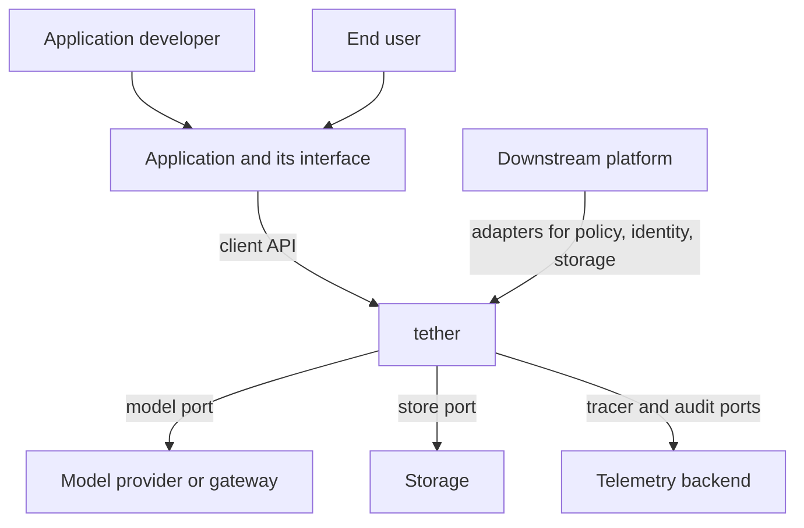
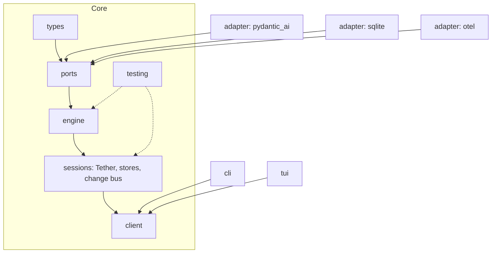
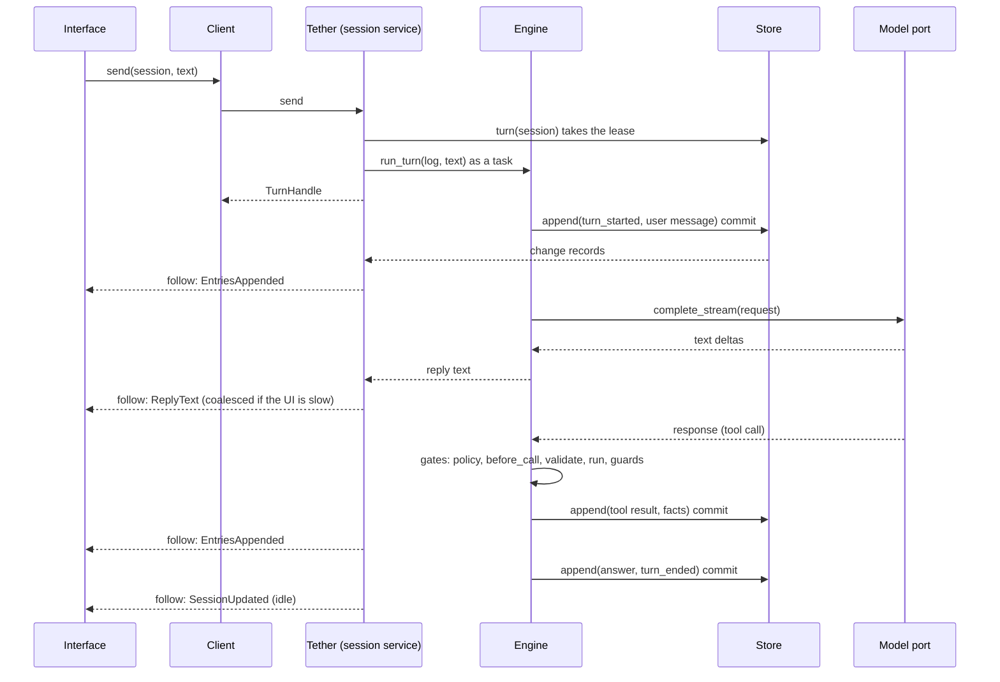

---
ddx:
  id: architecture
  type: architecture
  activity: design
  status: draft
  owner: Erik LaBianca
  updated: 2026-10-21
  authoring:
    home: repo
  links:
    - id: product-vision
      kind: informed_by
    - id: prd
      kind: informed_by
    - id: concerns
      kind: informed_by
    - id: ADR-001
      kind: informed_by
    - id: ADR-002
      kind: informed_by
    - id: ADR-003
      kind: informed_by
    - id: ADR-004
      kind: informed_by
    - id: ADR-005
      kind: informed_by
    - id: SPIKE-001
      kind: informed_by
---

# Architecture

## Scope

This architecture covers the tether library, its optional adapters, its test kit, and its two reference clients. It is driven by the [PRD](../01-frame/prd.md): an asynchronous loop with a model port, a tool interface, durable sessions, telemetry, and a client API that lets any interface list sessions, read them, and follow live turns. Outside the boundary: any application built on tether, any server or web interface over the client API, the model providers, and the storage systems other than the in-memory and SQLite stores.

## Level 1: System Context

| Element | Type | Purpose | Protocol |
|---------|------|---------|----------|
| Application developer | User | Embeds tether, writes tools, composes ports | Python import |
| End user | User (of an application) | Talks to an agent through the application's interface | Application-defined |
| Application and its interface (terminal UI, web server, notebook) | External | Drives tether through the client API; owns identity and presentation | In-process async Python (CONTRACT-003) |
| Model provider or gateway | External | Answers model calls | HTTPS, OpenAI-compatible chat completions (through Pydantic AI) |
| Storage (in-memory, SQLite, other) | External | Persists session logs | Store port (CONTRACT-003) |
| Telemetry backend | External | Receives spans and audit entries | OpenTelemetry (OTel) export |
| Downstream platform | External | The first multi-user consumer; supplies policy, identity, and storage adapters | Ports (CONTRACT-002, CONTRACT-003) |

## Level 2: Container Diagram

tether ships as one Python distribution, `tether`, with optional extras. These are not separate services: every container runs inside the consumer's process.

| Container | Technology | Responsibilities | Communication |
|-----------|------------|------------------|---------------|
| Core | Python 3.11+, `pydantic` v2, `anyio` | Types, ports, the engine (loop, tool pipeline, gates), the session service, the client API, the in-memory store, the test kit | In-process async calls |
| Model adapter (`pydantic-ai` extra) | Pydantic AI (`pydantic-ai-slim`), `httpx`, `openai` | Implements the model port over provider APIs (ADR-002) | HTTPS to the provider |
| SQLite store (`sqlite` extra) | Standard library `sqlite3` in worker threads | Durable store, summaries, change records, leases | A local file |
| OTel adapter (`otel` extra) | `opentelemetry-sdk` | Implements the tracer and audit ports | OTLP over HTTP, as configured |
| Reference CLI (`cli` extra) | Python, `pydantic-settings` | List, show, send, follow, approve, replay | Client API in process |
| Reference TUI (`tui` extra) | A terminal UI library (open question) | Session list, live transcript, approvals | Client API in process |

## Level 3: Component Diagram

| Component | Container | Purpose | Notes |
|-----------|-----------|---------|-------|
| Engine | Core | Runs a turn: spec resolution, scope binding, model steps, tool pipeline, gates, confirmation | Owns the gate sequence (CONTRACT-002 section 7) |
| Tool registry and `@tool` | Core | Registers tools by name, derives schemas from typed functions, offloads plain functions to threads | ADR-001 |
| Providers | Core | Contribute tools, capabilities, prompt sections, and hooks that only narrow | ADR-003 |
| Session service (`Tether`) | Core | Owns turn tasks, the lease, recovery, the change bus, and the client API | CONTRACT-003 |
| Change bus | Core | Fans persisted and live changes to followers with bounded, coalescing queues | ADR-004 |
| Summary projection | Core and stores | Keeps summaries current in the same commit as entries | ADR-005 |
| Test kit | Core | Dummies, conformance suites, cassettes, benchmarks | FR-28 |

## Module Boundaries

**Source Applicability**: source. Hand-written Python under `src/tether/`, in one distribution with optional extras. Module ownership and the dependency rules below follow the `hexagonal-architecture` and `modularity-and-encapsulation` concerns.

| Module | Responsibility / Owned Types | Public API | Allowed Dependencies | Forbidden Dependencies |
|--------|------------------------------|------------|----------------------|------------------------|
| `tether.types` | Pure payload types: messages, tools, entries, summaries, views, queries, pages, `AgentSpec`, `Actor`, decisions, changes, errors | The names in CONTRACT-001 to CONTRACT-003 | `pydantic`, standard library | Everything else in `tether`, `anyio`, any extra |
| `tether.ports` | The `Protocol` classes for every port | The ports in CONTRACT-001 to CONTRACT-003 | `tether.types` | The engine, sessions, any adapter, any third-party package except `pydantic` |
| `tether.engine` | The loop, the tool pipeline, gates, built-in guards, provider registry, `@tool` | `Engine`, `tool`, `BaseProvider` | `tether.types`, `tether.ports`, `anyio` | Sessions, client, adapters, clients, the environment |
| `tether.sessions` | `Tether`, turn tasks, lease and recovery, the change bus, summary projection helpers, `InMemoryStore` | `Tether` | `tether.types`, `tether.ports`, `tether.engine`, `anyio` | Client, adapters, clients, the environment |
| `tether.client` | The `Client` implementation | `Client` | `tether.types`, `tether.sessions` | Adapters, clients, the environment |
| `tether.testing` | Dummies, conformance suites, cassette read and write, benchmark helpers, `drive` | The names in the contracts | The core modules; `pytest` and `anyio` plugin for the suites | Adapters that need an extra |
| `tether.adapters.pydantic_ai` | The model adapter; owns every `pydantic_ai`, `openai`, and `httpx` import | `PydanticAIModel` | `tether.types`, `tether.ports`, its extra | The engine, sessions, other adapters |
| `tether.adapters.sqlite` | The SQLite store; owns every `sqlite3` import | `SqliteStore` | `tether.types`, `tether.ports` | The engine, other adapters |
| `tether.adapters.otel` | The OTel tracer and audit sink; owns every `opentelemetry` import | `OtelTracer`, `OtelAuditSink` | `tether.types`, `tether.ports`, its extra | The engine, other adapters |
| `tether.cli`, `tether.tui` | The reference clients and their composition roots | A console script each | `tether.client`, `tether.sessions`, adapters, `pydantic-settings`, a TUI library | Engine internals, store internals |

**Integration Owners**: the model provider and `httpx` belong to `tether.adapters.pydantic_ai`; SQLite to `tether.adapters.sqlite`; OpenTelemetry to `tether.adapters.otel`; a terminal UI library to `tether.tui`. Each translates its vendor's data, errors, and transport at its boundary (for example, Pydantic AI's error text, which includes response bodies, is reduced to a status code in the adapter).

**Construction Policy**: the application is the composition root. `Tether(...)` and `Engine(...)` take their ports as arguments. No module in the core reads the environment or holds a module-level singleton. The reference clients are composition roots for their own use and build their configuration with `pydantic-settings`.

**Boundary Check**: `python3 scripts/check_layers.py` (to be created in slice 0; it will also run in the pre-commit hook and in CI) fails on any import that the table forbids, including function-local and type-checking imports. A second check installs only the core's dependencies in a clean environment and runs the core test suite, so an undeclared import fails. Each rule has a negative control (a planted forbidden import that the check must reject).

## Deployment

| Component | Infrastructure | Instances | Scaling | Backup / Recovery |
|-----------|----------------|-----------|---------|-------------------|
| The library | Published to a Python package index; consumed by pip or uv | n/a | n/a | n/a (a release can be yanked) |
| A consumer's process | The consumer's runtime | The consumer's choice | One event loop per process; sessions are independent | The store holds the log; leases and recovery resolve a crashed turn |
| CI | A hosted CI service (GitHub Actions is assumed because the repository is expected on GitHub; to confirm) | One pipeline per push | n/a | n/a |

## Data Flow

The most important flow: an interface sends a message and follows the live turn.

## Quality Attributes

Numeric budgets are set by Erik LaBianca after the first benchmark baseline; until then the target is "measured and protected against regression".

| Attribute | Target | Strategy | Verification |
|-----------|--------|----------|--------------|
| Performance | Budgets for list, get, entry page, append, and follow latency and memory, set from a baseline | Materialized summaries, keyset cursors, position-addressed pages, delta feed, bounded queues, models validated at write (ADR-004) | Benchmark suite with committed baseline, run in CI |
| Reliability | A turn killed between steps loses no committed step and duplicates none | Per-step atomic commits, leases with heartbeats, idempotent keys, recovery (ADR-005) | Kill-between-steps tests, in process and by real process kill on SQLite |
| Concurrency | Many sessions on one event loop; a slow follower never slows the engine | Async throughout, bounded coalescing queues, plain functions offloaded (ADR-001) | Concurrency and backpressure conformance tests |
| Security | No content or credential in telemetry or cassettes; gates fail closed; providers only narrow | Content-free telemetry, error scrubbing, recorder strips identity and requires fabricated prompts, narrow-only provider hooks | Telemetry content test, provider suite, cassette tests |
| Testability | Every port has a dummy and a suite; the loop replays recorded conversations | Ports and dummies, cassettes (CONTRACT-001) | The suites run in CI |
| Portability | Linux and macOS, Python 3.11 and later | Standard-library store, pure-Python core | CI matrix |
| Disaster Recovery | Not applicable to a library; a store adapter's backup is the consumer's | n/a | n/a |

## Decisions and Tradeoffs

| Decision | Status | Rationale | Follow-up |
|----------|--------|-----------|-----------|
| Asynchronous only, plain functions offloaded ([ADR-001](adr/ADR-001-the-library-and-its-ports-are-asynchronous-and-sync-code-is-offloaded.md)) | Proposed | One interface; cancellation; native Pydantic AI | ASYNC lint rules; concurrency tests |
| Pydantic AI as the model client behind a port ([ADR-002](adr/ADR-002-pydantic-ai-is-the-model-client-behind-the-model-port.md)) | Proposed | No provider HTTP code to maintain; SPIKE-001 evidence | Live smoke call in slice 1 |
| A library of ports and providers with its own loop ([ADR-003](adr/ADR-003-tether-is-a-library-of-ports-and-providers-and-builds-its-own-loop.md)) | Proposed | Embeddable; no second owner of session state | Validate with the first downstream platform |
| The UI boundary is an in-process async API ([ADR-004](adr/ADR-004-the-ui-boundary-is-an-in-process-async-python-api-over-summaries-pages-and-a-change-feed.md)) | Proposed | A fast, simple boundary with no server dependency | Benchmarks and budgets |
| Sessions are append-only logs committed per step ([ADR-005](adr/ADR-005-a-session-is-an-append-only-entry-log-committed-per-step.md)) | Proposed | Live reads, crash recovery, projections that cannot disagree | A staging-adapter option for all-or-nothing turns |
| MIT OR Apache-2.0, copyright Synaptiq, clean history ([ADR-006](adr/ADR-006-tether-is-dual-licensed-mit-or-apache-2-with-synaptiq-copyright-and-a-clean-history.md)) | Accepted | Adopter choice of terms; reviewable history | Contribution policy and the legal entity name |
| SQLite access through the standard library in worker threads | Open | No new dependency | An ADR when the SQLite slice begins |
| The terminal UI library | Open | Textual is the recommendation | An ADR when the TUI slice begins |
