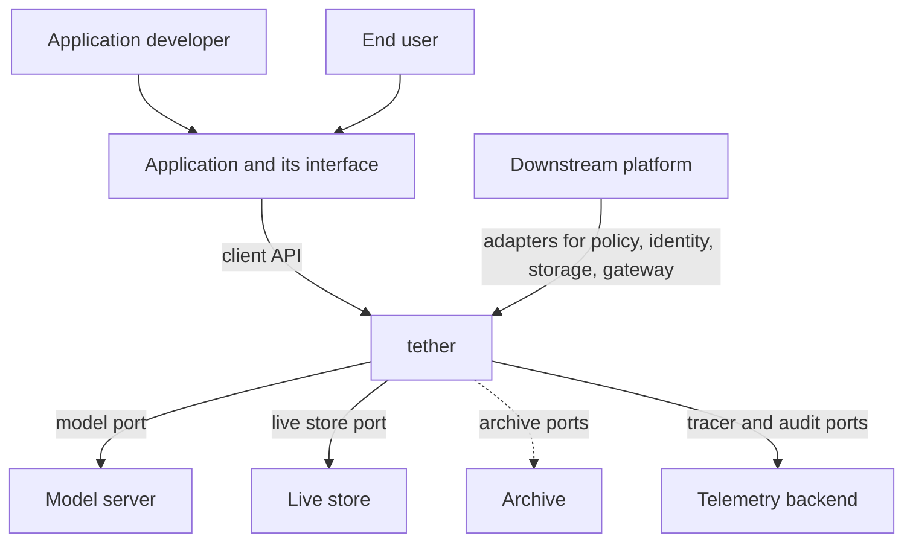
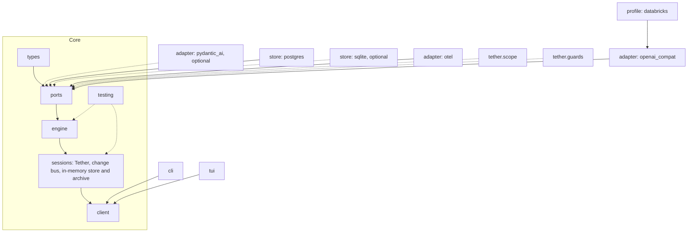

---
ddx:
  id: architecture
  type: architecture
  activity: design
  status: draft
  owner: Erik LaBianca
  updated: 2026-10-22
  authoring:
    home: repo
  links:
    - id: product-vision
      kind: informed_by
    - id: prd
      kind: informed_by
    - id: concerns
      kind: informed_by
    - id: ADR-001
      kind: informed_by
    - id: ADR-002
      kind: informed_by
    - id: ADR-003
      kind: informed_by
    - id: ADR-004
      kind: informed_by
    - id: ADR-005
      kind: informed_by
    - id: SPIKE-001
      kind: informed_by
    - id: SPIKE-002
      kind: informed_by
    - id: ADR-012
      kind: informed_by
    - id: ADR-013
      kind: informed_by
    - id: ADR-014
      kind: informed_by
    - id: ADR-015
      kind: informed_by
    - id: ADR-016
      kind: informed_by
    - id: ADR-017
      kind: informed_by
    - id: ADR-018
      kind: informed_by
    - id: ADR-019
      kind: informed_by
    - id: ADR-020
      kind: informed_by
---

# Architecture

## Scope

This architecture covers the tether library, its optional adapters, stores, and packages, its test kit, and its two reference clients. It is driven by the [PRD](../01-frame/prd.md): an asynchronous loop with a model port, a tool interface, durable sessions with crash recovery, telemetry, and a client API that lets any interface list sessions, read them, and follow live turns. Outside the boundary: any application built on tether, any server or web interface over the client API, the model servers themselves, and storage systems other than the stores named below.

## Level 1: System Context

| Element | Type | Purpose | Protocol |
|---------|------|---------|----------|
| Application developer | User | Embeds tether, writes tools, composes ports | Python import |
| End user | User (of an application) | Talks to an agent through the application's interface | Application-defined |
| Application and its interface (terminal UI, web server, notebook) | External | Drives tether through the client API; owns identity, presentation, and its own records | In-process async Python (CONTRACT-003) |
| Model server (local, self-hosted, sovereign, a platform gateway, or hosted) | External | Answers model calls | HTTP, the OpenAI-compatible chat-completions protocol (ADR-012) |
| Live store (in-memory, Postgres, optionally SQLite) | External | Holds in-flight and recent session logs | Live store port (CONTRACT-003) |
| Archive (optional) | External | Holds finished sessions, or reconstructs them from a platform log such as a gateway's inference tables | Archive ports (CONTRACT-003) |
| Telemetry backend | External | Receives spans and audit entries | OpenTelemetry (OTel) export |
| Downstream platform | External | The first multi-user consumer; supplies policy, identity, storage, and gateway adapters | Ports (CONTRACT-002, CONTRACT-003) |



## Level 2: Container Diagram

tether ships as one Python distribution, `tether`, with optional extras. These are not separate services: every container runs inside the consumer's process.

| Container | Technology | Responsibilities | Communication |
|-----------|------------|------------------|---------------|
| Core | Python 3.11+, `pydantic` v2, `anyio` | Types, ports, the engine (loop, tool pipeline, gates, approval, resume planner), the session service, the client API, the in-memory live store and archive, the test kit | In-process async calls |
| Default model adapter (`models` extra) | `httpx` only | Implements the model port over the OpenAI-compatible protocol, ported from a tested in-house client (ADR-002) | HTTP to the model server |
| Databricks profile (`databricks` extra) | The default adapter plus `databricks-sdk` for authentication only | Route, tier-to-service mapping, attribution tags, identity modes for the Databricks AI Gateway; later a derived archive over its inference tables (ADR-013) | HTTP to the gateway |
| Optional model adapter (`pydantic-ai` extra) | Pydantic AI | Implements the port for providers outside the protocol; never a default (ADR-002) | The provider's API |
| Postgres live store (`postgres` extra) | `psycopg` with its pool | Durable live store with summaries, change records, leases, and notifications (ADR-020) | A Postgres server |
| Embedded Postgres (`pgserver` extra) | `pgserver-pg18` | Starts a local PostgreSQL 18 for zero-setup durability (ADR-020) | A local process |
| SQLite live store (optional) | Standard library `sqlite3` in worker threads | A file-backed live store, if built (ADR-009) | A local file |
| OTel adapter (`otel` extra) | `opentelemetry-sdk` | Implements the tracer and audit ports | OTLP over HTTP, as configured |
| Optional packages `tether.scope`, `tether.guards` | Core only | Fixed and growing scope keys and the bound-context guard; the injection heuristic (ADR-017) | In-process |
| Reference CLI (`cli` extra) | Python, `pydantic-settings` | List, show, send, follow, approve, resume, replay | Client API in process |
| Reference TUI (`tui` extra) | Textual (ADR-008) | Session list, live transcript, approvals, resume | Client API in process |



## Level 3: Component Diagram

| Component | Container | Purpose | Notes |
|-----------|-----------|---------|-------|
| Engine | Core | Runs a turn: spec resolution, scope binding, model steps, the tool pipeline, gates, approval | Owns the gate sequence (CONTRACT-002 section 8) |
| Tool registry and `@tool` | Core | Registers tools by name, derives schemas from typed functions, offloads plain functions to threads | ADR-001 |
| Providers | Core | Contribute tools, capabilities, prompt sections, and hooks whose outputs the engine validates | ADR-003, ADR-016 |
| Approval and execution state | Core | Binds an approval to an invocation; derives not-started, started, finished, and resolved from the log | ADR-014, ADR-015 |
| Resume planner | Core | A pure function from a log and tool declarations to a resume plan | ADR-010 |
| Session service (`Tether`) | Core | Owns turn tasks, the lease, recovery, the change bus, and the client API | CONTRACT-003 |
| Change bus | Core | Fans persisted and live changes to followers with bounded, coalescing queues | ADR-004 |
| Summary projection | Core and stores | Keeps summaries current in the same commit as entries | ADR-005 |
| Live store and archive ports | Core | The two storage boundaries and their declared capabilities | ADR-019 |
| Test kit | Core | Dummies, conformance suites, cassettes, benchmarks | FR-28 |

## State Ownership

Each kind of state has one owner (ADR-018). An application with its own sessions holds a reference to a tether session and never a second copy of the conversation.

| State | Owner | Where it lives | Contract |
|-------|-------|----------------|----------|
| Loop state (the stream in progress, the step counter, task handles) | The engine, in memory | The process only; rebuilt from the log | CONTRACT-002 section 8 |
| Durable execution state (the lease, intents, approvals, the resume chain) | Tether and its live store | The log and the lease record | CONTRACT-003 section 3 |
| Conversation history | Tether | The live store's log; archived by policy; read through the client API | CONTRACT-003 |
| Application state (users, documents, entitlements, artifacts, business records) | The application | Its own storage | Reaches tools as capabilities and the policy; never in a session type |
| Model-call detail in a platform log (payloads in a gateway's inference tables) | The platform | The platform's tables | Read on demand through a derived archive (ADR-019) |

## Trust Boundaries

Python tools and providers are trusted application code (ADR-016); the library runs in the application's process and is not a sandbox. The boundary the architecture defends is between the engine's invariants and extension behavior (CONTRACT-002 section 7). Untrusted code is isolated outside the core, behind a tool in a subprocess or a sandbox, or behind the P2 MCP adapter. Credentials cross only from the application's actor to the model adapter and to tools, in memory, for one call (ADR-011). The model server is an external trust boundary: its replies are untrusted input, validated before use, and an injection heuristic, if configured, is a signal and not a boundary (ADR-017).

## Module Boundaries

**Source Applicability**: source. Hand-written Python under `src/tether/`, in one distribution with optional extras. Module ownership and the dependency rules below follow the `hexagonal-architecture` and `modularity-and-encapsulation` concerns.

| Module | Responsibility / Owned Types | Public API | Allowed Dependencies | Forbidden Dependencies |
|--------|------------------------------|------------|----------------------|------------------------|
| `tether.types` | Pure payload types: messages, tools, entries, summaries, views, queries, pages, `AgentSpec`, `Actor`, decisions, changes, errors | The names in CONTRACT-001 to CONTRACT-003 | `pydantic`, standard library | Everything else in `tether`, `anyio`, any extra |
| `tether.ports` | The `Protocol` classes for every port, including the live store and the archive | The ports in CONTRACT-001 to CONTRACT-003 | `tether.types` | The engine, sessions, any adapter, any third-party package except `pydantic` |
| `tether.engine` | The loop, the tool pipeline, gates, approval, the resume planner, provider registry, `@tool` | `Engine`, `tool`, `BaseProvider`, `plan_resume` | `tether.types`, `tether.ports`, `anyio` | Sessions, client, adapters, stores, optional packages, clients, the environment |
| `tether.sessions` | `Tether`, turn tasks, lease and recovery, the change bus, summary projection helpers, `InMemoryStore`, `InMemoryArchive` | `Tether` | `tether.types`, `tether.ports`, `tether.engine`, `anyio` | Client, adapters, stores other than the in-memory ones, clients, the environment |
| `tether.client` | The `Client` implementation | `Client` | `tether.types`, `tether.sessions` | Adapters, clients, the environment |
| `tether.testing` | Dummies, conformance suites, cassette read and write, benchmark helpers, `drive` | The names in the contracts | The core modules; `pytest` and the `anyio` plugin for the suites | Adapters that need an extra |
| `tether.adapters.openai_compat` | The default model adapter; owns the OpenAI-compatible protocol and every `httpx` import | `OpenAICompatModel` | `tether.types`, `tether.ports`, `httpx` | The engine, sessions, other adapters, every banned SDK |
| `tether.adapters.databricks` | The Databricks profile; owns every `databricks.sdk` import | `databricks_gateway(...)` | `tether.adapters.openai_compat`, `tether.types`, `tether.ports`, `databricks-sdk` | The engine, sessions, other profiles, every banned SDK |
| `tether.adapters.pydantic_ai` | The optional model adapter; owns every `pydantic_ai` import | `PydanticAIModel` | `tether.types`, `tether.ports`, its extra | The engine, sessions, other adapters, every banned SDK (it builds models through Pydantic AI's provider classes and does not import `openai` itself) |
| `tether.stores.postgres` | The Postgres live store and its migration runner; owns every `psycopg` import. `tether.stores.postgres.embedded` owns every `pgserver` import | `PostgresStore` | `tether.types`, `tether.ports`, `psycopg` | The engine, other stores |
| `tether.stores.sqlite` (optional) | The SQLite live store; owns every `sqlite3` import | `SqliteStore` | `tether.types`, `tether.ports` | The engine, other stores |
| `tether.adapters.otel` | The OTel tracer and audit sink; owns every `opentelemetry` import | `OtelTracer`, `OtelAuditSink` | `tether.types`, `tether.ports`, its extra | The engine, other adapters |
| `tether.scope`, `tether.guards` | Optional packages: scope kinds and the bound-context guard; the injection heuristic | Their guards and kinds | `tether.types`, `tether.ports` | The engine, sessions |
| `tether.cli`, `tether.tui` | The reference clients and their composition roots | A console script each | `tether.client`, `tether.sessions`, adapters, `pydantic-settings`, Textual (the TUI only) | Engine internals, store internals |

**Integration Owners**: the model server and `httpx` belong to `tether.adapters.openai_compat`; the Databricks SDK to `tether.adapters.databricks`; Pydantic AI to `tether.adapters.pydantic_ai`; Postgres to `tether.stores.postgres`; the embedded server to its `embedded` module; SQLite to `tether.stores.sqlite`; OpenTelemetry to `tether.adapters.otel`; Textual to `tether.tui`. Each translates its vendor's data, errors, and transport at its boundary (for example, an HTTP error response's body is reduced to a status code and a scrubbed, allow-listed code in the default adapter).

**Construction Policy**: the application is the composition root. `Tether(...)` and `Engine(...)` take their ports as arguments. No module in the core reads the environment or holds a module-level singleton. The reference clients are composition roots for their own use and build their configuration with `pydantic-settings`.

**Boundary Check**: `python3 scripts/check_layers.py` (to be created in slice 0; it will also run in the pre-commit hook and in CI) fails on any import that the table forbids, including function-local and type-checking imports. A second check installs only the core's dependencies in a clean environment and runs the core test suite, so an undeclared import fails. Each rule has a negative control (a planted forbidden import that the check must reject). The check also holds the **banned SDK list** (ADR-012): no module imports `openai`, `anthropic`, `claude_agent_sdk`, `google.genai`, `google.generativeai`, `vertexai`, `mistralai`, `cohere`, or `groq`, and a test lists the default install's dependency tree and fails if any of them is in it. An exception needs an ADR.

## Deployment

| Component | Infrastructure | Instances | Scaling | Backup / Recovery |
|-----------|----------------|-----------|---------|-------------------|
| The library | Published to a Python package index; consumed by pip or uv | n/a | n/a | n/a (a release can be yanked) |
| A consumer's process | The consumer's runtime | The consumer's choice | One event loop per process; sessions are independent | The live store holds the log; leases and recovery resolve a crashed turn, as far as the store's declared capabilities allow (CONTRACT-003 section 3) |
| The live store | In-memory, a Postgres server (or the embedded one), or SQLite | The consumer's choice | The store's own | The store's own backup; the archive holds finished sessions |
| CI | A hosted CI service (GitHub Actions is assumed because the repository is expected on GitHub; to confirm) | One pipeline per push | n/a | n/a |

### Runtime ownership and application deployment

ADR-003 retains one Python harness and excludes AgentKit. The engine owns model/tool transitions and gate execution; Tether's store contracts own authoritative conversation records and projections. The application's existing server owns authenticated requests and browser transport. A TypeScript UI consumes that server's contract. No additional invocation supervisor, compatibility server or second harness is introduced by this decision.

Databricks Apps remains the consuming application's deployment target. The operator reports an existing deployment; this library design does not claim that the deployed server has been audited against every proposed contract. A future runtime replacement must identify code to delete, preserve live-identity continuation and portability, and reduce total complexity. Do not add AgentKit as a speculative wrapper.

## Data Flow

The most important flow: an interface sends a message and follows the live turn, including an approved action whose tool is unsafe to rerun.

```mermaid
sequenceDiagram
    participant UI as Interface
    participant C as Client
    participant T as Tether (session service)
    participant E as Engine
    participant S as Live store
    participant M as Model port
    UI->>C: send(session, text)
    C->>T: send
    T->>S: turn(session) takes the lease
    T->>E: run_turn(log, text) as a task
    T-->>C: TurnHandle
    E->>S: append(turn_started, user message) commit
    S-->>T: change records
    T-->>UI: follow: EntriesAppended
    E->>M: stream(request with the actor's credential)
    M-->>E: text deltas
    E-->>T: reply text
    T-->>UI: follow: ReplyText (coalesced if the UI is slow)
    M-->>E: response (an unsafe tool call that needs approval)
    E->>E: gates 1 to 4; approval needed
    E->>S: append(confirmation requested) commit; the turn ends
    T-->>UI: follow: SessionUpdated (waiting)
    UI->>C: confirm(session, invocation id)
    C->>T: confirm (takes the lease)
    E->>E: re-enter the gates at 1; check digests
    E->>S: append(tool_call started) commit: the intent
    E->>E: run the tool
    E->>S: append(tool result, tool_call ok) commit
    E->>M: stream(next request)
    E->>S: append(answer, turn_ended) commit
    T-->>UI: follow: SessionUpdated (idle)
```

If the process dies after the intent commit and before the result commit, recovery marks the turn interrupted, and a present caller resumes it; the tool, being unsafe, is recorded as outcome unknown and not rerun (ADR-014).

## Quality Attributes

The numeric targets are the proposals in the PRD (NFR-7), made on 2026-10-22 at the owner's request. The first benchmark baseline validates or replaces each; a validated one becomes a committed budget that CI protects against regression.

| Attribute | Target | Strategy | Verification |
|-----------|--------|----------|--------------|
| Performance | The NFR-7 targets at the reference workload (for example, a page of 50 summaries from 10,000 sessions in at most 10 ms at the 99th percentile on a durable store) | Materialized summaries, keyset cursors, position-addressed pages, delta feed, bounded queues, models validated at write (ADR-004) | Benchmark suite with committed baseline, run in CI |
| Reliability | Each committed entry appears once; a tool that is not safe is run at most once automatically; an unknown outcome is explicit; there is no claim of exactly-once external effects. These hold on a store that declares durable commits and fenced leases (CONTRACT-003 section 3) | Per-step atomic commits, intent before effect, stable invocation ids, leases with fencing, a deterministic resume planner (ADR-005, ADR-010, ADR-014) | Prefix tests over every log prefix, in-process and real-process kill tests on a durable store |
| Concurrency | Many sessions on one event loop; a slow follower never slows the engine | Async throughout, bounded coalescing queues, plain functions offloaded (ADR-001) | Concurrency and backpressure conformance tests |
| Security | No content or credential in telemetry or cassettes; the engine's invariants hold against a buggy extension; extension code is trusted, not sandboxed | Content-free telemetry, error scrubbing, the recorder strips identity, validated provider outputs, explicit trust model (ADR-016) | Telemetry content test, provider and approval suites, cassette tests |
| Time to try | A fresh clone to a running terminal UI on the demo model in at most 10 s on a warm package cache | A scripted demo model and an in-memory store, no network, no credential, the reference clients in the repository's development environment (FR-33) | The timed quickstart test in CI |
| Provider independence | No foundation-model provider SDK in the default install; any OpenAI-compatible server works by configuration; the Databricks AI Gateway is supported and never the only backend | The owned adapter over `httpx`, the banned SDK list, server parameters passed through, the Databricks profile (ADR-012, ADR-013) | The boundary check, the dependency-tree test, and a conformance matrix with at least one non-Databricks server |
| Testability | Every port has a dummy and a suite; the loop replays recorded conversations | Ports and dummies, cassettes (CONTRACT-001) | The suites run in CI |
| Portability | Linux and macOS, Python 3.11 and later | A pure-Python core; optional extras | CI matrix |
| Disaster Recovery | Not applicable to a library; a store's backup is the consumer's | n/a | n/a |

## Decisions and Tradeoffs

| Decision | Status | Rationale | Follow-up |
|----------|--------|-----------|-----------|
| Asynchronous only, plain functions offloaded ([ADR-001](adr/ADR-001-the-library-and-its-ports-are-asynchronous-and-sync-code-is-offloaded.md)) | Proposed | One interface; cancellation; native asynchronous model clients | `ASYNC` lint rules; concurrency tests |
| The default model adapter speaks the OpenAI-compatible protocol over `httpx`; Pydantic AI is optional ([ADR-002](adr/ADR-002-the-default-model-adapter-speaks-the-openai-compatible-protocol-over-httpx-and-pydantic-ai-is-optional.md)) | Proposed | No provider SDK; a port of a tested client; SPIKE-002 | A conformance matrix of local servers in slice 1 |
| A Python library of ports and providers with its own loop; no AgentKit ([ADR-003](adr/ADR-003-tether-is-a-library-of-ports-and-providers-and-builds-its-own-loop.md)) | Accepted | Direct Python embedding and owned execution/session semantics; existing application server serves the UI | Prove contract behavior; reconsider only a concrete simplifying replacement |
| The UI boundary is an in-process async API ([ADR-004](adr/ADR-004-the-ui-boundary-is-an-in-process-async-python-api-over-summaries-pages-and-a-change-feed.md)) | Proposed | A fast, simple boundary with no server dependency | Benchmarks and budgets |
| Sessions are append-only logs committed per step, with declared store capabilities ([ADR-005](adr/ADR-005-a-session-is-an-append-only-entry-log-committed-per-step.md)) | Proposed | Live reads, crash recovery, projections that cannot disagree | A visibility watermark when a consumer needs one |
| MIT OR Apache-2.0, copyright FocusedDiversity LLC, clean history ([ADR-006](adr/ADR-006-tether-is-dual-licensed-mit-or-apache-2-with-focuseddiversity-copyright-and-a-clean-history.md)) | Accepted | Adopter choice of terms; reviewable history | None |
| Contributions are welcome directly, with no CLA, and accepted as prompts ([ADR-007](adr/ADR-007-contributions-are-welcome-directly-with-no-cla-and-are-accepted-as-prompts.md)) | Accepted | No legal hurdle; little provenance risk | `CONTRIBUTING.md` and the templates |
| The reference TUI uses Textual; the CLI uses the standard library ([ADR-008](adr/ADR-008-the-reference-tui-uses-textual-and-the-cli-uses-only-the-standard-library.md)) | Accepted | Asynchronous TUI; no CLI dependency | Headless TUI tests in the TUI slice |
| The SQLite store, if built, uses the standard library in worker threads ([ADR-009](adr/ADR-009-the-sqlite-store-uses-the-standard-library-in-worker-threads.md)) | Accepted | No new dependency; real transactions | Built only if the quickstart needs it (ADR-020) |
| A killed turn is resumed explicitly from its log by a deterministic planner ([ADR-010](adr/ADR-010-a-turn-killed-mid-run-is-resumed-explicitly-from-its-log-by-a-deterministic-planner.md)) | Proposed | Crash safety without an external engine; identity is never stored | The prefix test; confirm the `report` default |
| Identity is an explicit credential on the actor and is never stored ([ADR-011](adr/ADR-011-identity-is-an-explicit-credential-on-the-actor-and-is-never-stored.md)) | Proposed | Visible, testable, concurrency-safe | Adapter and tool tests |
| No foundation-model provider SDK; local and sovereign models first-class ([ADR-012](adr/ADR-012-tether-depends-on-no-foundation-model-provider-sdk-and-local-and-sovereign-models-are-first-class.md)) | Accepted | Operator design goal; runs wherever a compatible server runs | The banned SDK list in the boundary check |
| The Databricks AI Gateway is a first-class profile, never the only backend ([ADR-013](adr/ADR-013-the-databricks-ai-gateway-is-a-first-class-backend-delivered-as-a-profile-and-never-the-only-backend.md)) | Accepted | The first consumer's backend, without shaping the core | A conformance matrix with a non-Databricks server |
| External actions are recorded as intent before execution; an unknown outcome is explicit ([ADR-014](adr/ADR-014-external-actions-are-recorded-as-intent-before-execution-with-a-stable-invocation-id-and-an-unknown-outcome-is-explicit.md)) | Proposed | Honest recovery without an exactly-once claim | Intent latency budget from the baseline |
| An approval binds to one invocation, its arguments, and its tool definition ([ADR-015](adr/ADR-015-an-approval-binds-to-one-invocation-its-arguments-and-its-tool-definition-and-satisfies-only-the-approval-gate.md)) | Proposed | A person approves what they saw, and only that | `approval_ttl`, if any |
| Extension code is trusted in-process code; the core enforces engine invariants ([ADR-016](adr/ADR-016-extension-code-is-trusted-in-process-application-code-and-the-core-enforces-engine-invariants-not-extension-behavior.md)) | Proposed | No false sandbox claim | An optional `security-architecture` artifact |
| The core keeps the ports and gates; scope kinds, engagement, suggestions, and the injection scanner are optional ([ADR-017](adr/ADR-017-the-core-keeps-the-ports-and-the-gate-sequence-and-scope-kinds-engagement-suggestions-and-the-injection-scanner-are-optional.md)) | Proposed | A small core; scanning stated as a heuristic | Parity run with the first consumer |
| The session log is the single source of truth; an application holds a reference ([ADR-018](adr/ADR-018-tethers-session-log-is-the-single-source-of-truth-for-an-agent-conversation-and-an-application-holds-a-reference.md)) | Proposed | One owner per kind of state | Confirm the first consumer can hold a reference |
| Session storage is two ports, a live store and an archive ([ADR-019](adr/ADR-019-session-storage-is-two-ports-a-live-store-and-an-archive.md)) | Proposed | Hot and cold needs differ; a gateway's log can be a derived archive | Content-by-reference design in the Databricks slice |
| The default stores are in-memory and Postgres, with an optional embedded server; SQLite is optional ([ADR-020](adr/ADR-020-the-default-stores-are-in-memory-and-postgres-with-an-optional-embedded-server-and-sqlite-is-optional.md)) | Proposed | Matches the first consumer; ports tested code | Embedded-server start time against the quickstart budget |
