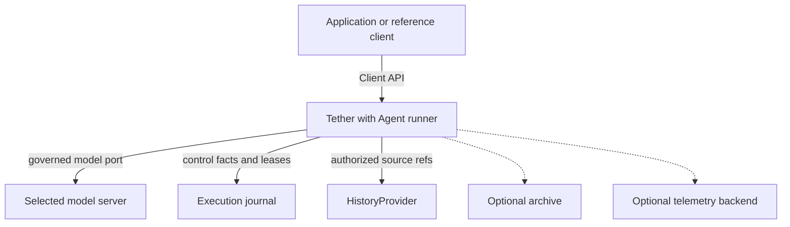
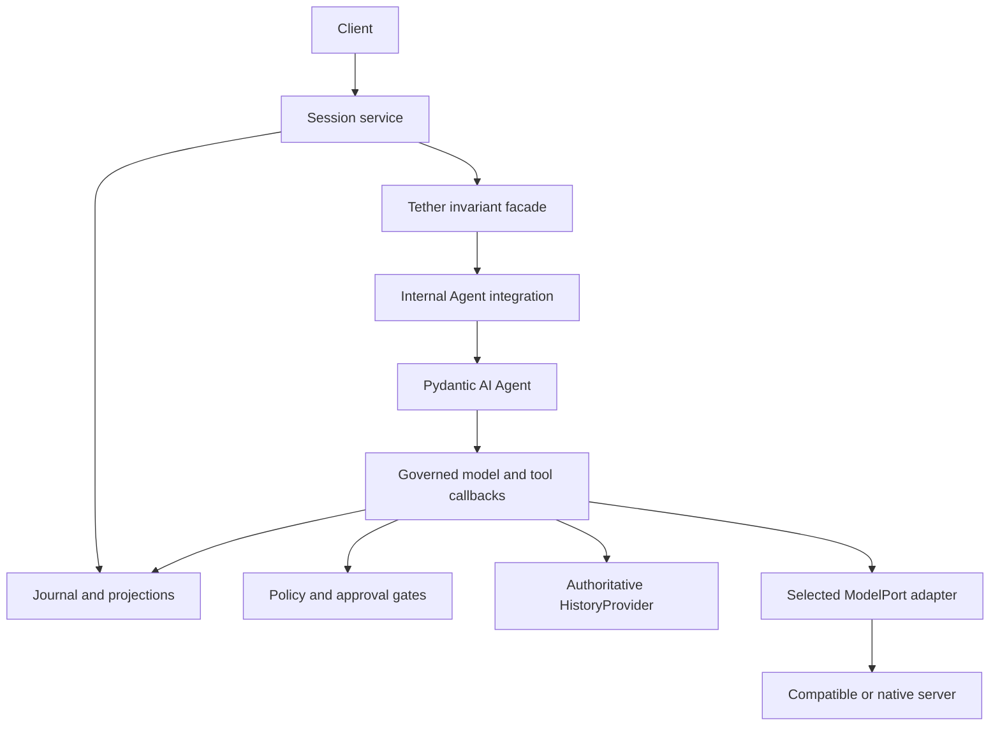

---
ddx:
  id: architecture
  type: architecture
  activity: design
  status: draft
  owner: Erik LaBianca
  updated: 2026-10-24
  authoring:
    home: repo
  links:
    - id: product-vision
      kind: informed_by
    - id: prd
      kind: informed_by
    - id: concerns
      kind: informed_by
    - id: ADR-001
      kind: informed_by
    - id: ADR-002
      kind: informed_by
    - id: ADR-003
      kind: informed_by
    - id: ADR-004
      kind: informed_by
    - id: ADR-005
      kind: informed_by
    - id: SPIKE-001
      kind: informed_by
    - id: SPIKE-002
      kind: informed_by
    - id: ADR-012
      kind: informed_by
    - id: ADR-013
      kind: informed_by
    - id: ADR-014
      kind: informed_by
    - id: ADR-015
      kind: informed_by
    - id: ADR-016
      kind: informed_by
    - id: ADR-017
      kind: informed_by
    - id: ADR-018
      kind: informed_by
    - id: ADR-019
      kind: informed_by
    - id: ADR-020
      kind: informed_by
    - id: ADR-021
      kind: informed_by
    - id: CONTRACT-004
      kind: informed_by
    - id: CONTRACT-005
      kind: informed_by
    - id: TP-001
      kind: informs
    - id: SPIKE-003
      kind: informed_by
    - id: SPIKE-004
      kind: informed_by
---

# Architecture

## Scope

Tether is an embedded asynchronous Python library built on Pydantic AI Agent (ADR-003). Agent supplies iteration and typed execution; Tether supplies the invariant facade, application policy, journal/history integration, recovery, session service and owner-scoped Client API. The CLI/TUI are reference clients. The application owns its server/browser transport and business state. No second general-purpose loop or AgentKit supervisor is planned.

The PRD and CONTRACT-001 through CONTRACT-005 define required behavior. SPIKE-003/004 provide bounded integration evidence, not blanket production support. SD-001 sequences delivery and qualification; TP-001 assigns proving layers.

## Level 1: System Context

| Element | Type | Purpose | Protocol |
|---|---|---|---|
| Application developer | User | Embeds Tether, provides tools/policy and configuration | Python import |
| End user | User | Drives the application's interface | Application-defined |
| Application / CLI / TUI | External or reference client | Owns identity and presentation; calls Client | In-process async API |
| Model servers | External | Local/self-hosted compatible subset or selected native provider | Qualified HTTP profile via model adapter |
| Execution journal | External | Accepted order, control facts, leases, projections and feed | Live-store port, CONTRACT-003 |
| Authoritative history | External | Original content and observed model exchanges | HistoryProvider, CONTRACT-005 |
| Archive | Optional external | Reference-complete retention/restore or explicitly partial legacy import | Archive ports |
| Telemetry backend | Optional external | Receives metadata-only spans and audit | OTel adapter |



## Level 2: Container Diagram

These components run in one consumer process and one Python distribution. External stores/servers remain replaceable; Agent is an internal runtime dependency.

| Container | Technology | Responsibilities | Communication |
|---|---|---|---|
| Public core and session service | Pydantic, async Python/AnyIO | Public types/ports, invariant facade, session ownership, journal/history mediation, recovery and Client | Tether-owned async interfaces |
| Internal Agent integration | pydantic-ai-slim without provider extras | Agent execution, typed tools/output, deferral/correction, message/Conversation conversion and fixed trusted capabilities | Internal callbacks and ModelPort mediation |
| Model adapter integrations | Pydantic AI native/compatible models; selected provider extras | Provider mapping, strict model outcome/limits, current identity and every physical attempt; shared SDK conversion ownership | Qualified model server API |
| Databricks profile (optional) | Compatible integration and databricks-sdk in its extra | Explicit route/identity/tag configuration and caller-authorized GatewayHistory plus supplement | Qualified Gateway/API/table profile |
| Local JSONL execution/history | Standard library with async offload | Separate accepted journal batches and immutable content; local reference default | CONTRACT-003/005 |
| Postgres / embedded Postgres | Selected psycopg / pgserver extras | Multiprocess live journal, leases, notifications and optional embedded server | Postgres |
| SQLite (optional) | Standard-library sqlite3 with offload | Consumer-selected additional store | Local file |
| Telemetry integration (optional) | OTel SDK extra | Metadata-only tracer/audit and explicit exporter | OTLP as configured |
| Reference CLI / TUI | Standard library / Textual; composition settings | Offline durable JSONL demo and Client commands | Client API |



## Module Boundaries

**Source Applicability**: source project in design; the planned boundary checker must enforce this table before runtime implementation is accepted. SPIKE-004 source is a bounded fixture, not the production module layout.

| Module | Responsibility / Owned Types | Public API | Allowed Dependencies | Forbidden Dependencies |
|---|---|---|---|---|
| tether.types / tether.ports | Provider-neutral payloads and external-system protocols | CONTRACT-001 through CONTRACT-005 types/ports | Pydantic, typing, standard library | Agent/SDK objects and optional integrations |
| tether.models | ModelPort stream framing, completion and canonical request snapshots | complete and model helpers (CONTRACT-001) | types, ports, Pydantic, standard library | Agent/SDK objects, native providers, stores, environment |
| tether.models.testing | Model doubles, fabricated cassette codecs and volatile attempt recorder | ScriptedModel, RecordingModel, ReplayModel, ListAttemptRecorder (CONTRACT-001/005) | models, types, ports, Pydantic, standard library/AnyIO | Native SDKs, required credentials, production durability claims |
| tether.engine | Tether invariant facade; spec/policy/guard order, context and commit callbacks, stable invocation/approval rules | Engine, tool declarations and Tether providers | types, ports, context, internal runtime integration, AnyIO | Provider SDKs, store/client implementations, environment, another graph/loop |
| tether.runtime.pydantic_ai | Owns Agent, generic Model bridge, SDK tool/message/Conversation codecs and fixed capability composition | Internal integration only | types, ports, internal Tether callback contracts, pydantic-ai-slim, AnyIO | Engine/session implementations, native provider SDKs, stores, environment, SDK types in public Tether APIs, private graph imports |
| tether.context | Source-addressed strategy/estimator helpers and deterministic dummies | CONTRACT-004 strategies/estimators | types, ports, standard library, AnyIO | Independent model/store clients or another transcript authority |
| tether.sessions | Tether task ownership, lease/recovery orchestration, change bus and summary projections | Tether | types, ports, engine, AnyIO | Native provider SDKs, UI clients, environment |
| tether.client | Owner-authorized list/page/snapshot/follow/commands | Client | types, sessions | SDK state, adapter/store internals |
| tether.history | Source refs, history mediation, JSONL content, readiness/correlation helpers | HistoryProvider types and JsonlHistory | types, ports, standard library, AnyIO | Agent execution, provider SDKs, environment |
| tether.adapters.pydantic_ai | Native/compatible model implementations; provider settings, wire/errors/receipts and attempt mediation | ModelPort implementations with Tether-facing payloads | types, ports, canonical model helpers, shared runtime codecs, Pydantic AI model/provider APIs; explicitly selected optional provider SDK closure | Engine/session implementations, SDK types in public core payloads, implicit SDK retries or identity fallback |
| tether.adapters.openai_compat | Compatible-server configuration/profile over the selected model integration | OpenAICompatModel/profile as specified by the adapter design | types, ports, adapters.pydantic_ai | A second default HTTPX/SSE protocol implementation, hosted-only behavior |
| tether.adapters.databricks | Gateway configuration and authorized external-history reader; owns databricks.sdk imports | Gateway profile/history integration | types, ports, history, selected model/profile adapters, its extra | Engine/session internals, default-install platform dependency |
| tether.stores.jsonl | Single-writer execution journal, atomic batches, index rebuild and local fencing | JsonlSessionStore | types, ports, stores.projections, standard library, AnyIO | Agent/provider SDKs, environment |
| tether.stores.postgres / embedded | Live-store transaction/lease/feed and optional server lifecycle; own psycopg/pgserver imports | PostgresSessionStore and explicit embedded configuration | types, ports, selected extras | Agent/provider SDKs, engine internals |
| tether.stores.sqlite | Optional live-store implementation | SqliteStore | types, ports, sqlite3 and offload | Agent/provider SDKs, engine internals |
| tether.adapters.otel | Tracer/audit adapter; owns OTel imports | OtelTracer/OtelAuditSink | types, ports, selected extra | Content capture by default, engine implementation |
| tether.scope / tether.guards | Optional scope kinds, bound-context and heuristic guards | Declared guards/kinds | types, ports | Agent internals or a dispatch bypass |
| tether.testing | Public-port doubles/suites/cassettes and qualified runtime test helpers | Contract test kit | Core modules including context helpers and the named runtime integration; test dependencies | Required native provider extras/network credentials |
| tether.cli / tether.tui | Reference clients and their composition roots | Console scripts | Client, Tether, selected adapters/stores, settings, Textual for TUI | Engine/Agent/store internals |

**Integration Owners**: the internal runtime module owns Agent/capability/SDK message and Conversation conversion. Model adapters own provider-specific clients, wire parsing, settings and errors, using those shared codecs; do not build two conversion authorities. The compatible profile configures that adapter rather than reimplementing the protocol. Databricks owns platform authentication/history reads; stores own persistence drivers; OTel and Textual remain in their named integrations.

**Construction Policy**: the application/reference client is the composition root. Explicit settings select model tier/profile, identity mode, stores, limits, capabilities and optional adapters. Engine binds the internal Agent integration to Tether-owned callbacks; external systems enter through ports. SDK configuration and provider clients are constructed at the integration boundary; core code performs no environment discovery. Raw application SDK capabilities cannot be injected to bypass Tether gates.

**Boundary Check**: create scripts/check_layers.py in SD-001 slice 0. Allow production Pydantic AI imports only in the named runtime/model integration owners; integration tests may use public SDK APIs to prove those boundaries, while private graph imports remain forbidden; allow foundation-model SDKs only in installed optional model adapter closures. Reject vendor types in public core APIs, private graph imports, cycles and alternate-loop/default owned-client modules. Each rule needs a planted negative control. Clean base installation includes pydantic-ai-slim but excludes foundation-model SDKs; the offline scripted/custom model and core suites must work. Each installed extra receives its own closure/version tests. SDK use is not treated as hosted lock-in.

## Deployment

The library is embedded in a consumer process. Independent sessions may run concurrently, but one turn holds the session lease and initial tool batches are sequential. The application owns server/browser deployment; no extra Agent service is added. JSONL is the local reference journal/history default; explicit in-memory profiles are volatile. Postgres is the multiprocess profile; optional embedded server and SQLite are separately qualified.

Recovery is capability-qualified. A snapshot does not make external effects atomic. Current identity, durable facts, readable original arguments, original digests and the unresolved-effect barrier govern continuation. Agent history is rebuilt or loaded only from verified journal-bound derivative state.

## Data Flow

This contract trace shows a proposed production boundary, not a live-provider execution claim. The proving baseline is SPIKE-004; full production qualification is in SD-001.

```mermaid
sequenceDiagram
    participant C as Client
    participant T as Session service / invariant facade
    participant A as Agent integration
    participant H as HistoryProvider
    participant J as Execution journal
    participant M as Governed model adapter
    C->>T: send with present actor
    T->>H: authorize READ_SESSION; persist accepted input
    T->>J: lease + input ref + turn start
    T->>A: run with verified source projection and callbacks
    A->>T: prepare context / model callback
    T->>H: authorized bounded source reads
    T->>J: commit context provenance
    T->>M: bounded request + identity + attempt recorder
    M->>J: reserve/render; authorize and commit each physical attempt
    M-->>A: provisional deltas then validated terminal response
    A->>H: persist/bind observed source response
    A->>J: commit reply reference and call manifest before tools
    A->>T: raw-source check; normalize; provider/approval gates
    T->>J: pending normalized binding and verified SDK checkpoint
    T-->>C: confirmation required
    C->>T: confirm with present actor
    T->>H: authorize pending/source reads
    T->>J: record winning approval under lease
    T->>A: resume verified derivative state
    A->>T: re-enter barrier and current gates
    T->>J: accepted intent before dispatch
    T->>T: execute tool; normalize/guard result
    T->>H: persist result content
    T->>J: atomically accept result fact/ref + projections/feed
    T-->>A: return accepted result
    A->>T: next governed model step
    T->>J: accept final answer and turn end
```

A failed/unknown intent or attempt commit prevents dispatch/egress. A possibly executed effect without an accepted result remains unknown. A replay-safe same-id recovery still checks its original bindings and fresh gates; every new effectful invocation remains blocked until resolution. Provisional text is attempt-scoped, never committed success. Model strict-terminal checks also cover structured-output paths that bypass ordinary function-tool hooks.

## History, Context and Recovery Boundaries

Journal facts own execution; HistoryProvider owns original messages/exchanges; Agent messages/Conversation and model context are derived. Accepted SDK checkpoints are versioned and bound to journal heads/source digests. Incoming proposals and tool results must correspond to authorized original/result records; a cache cannot supply invented success or substituted arguments. Unknown codecs fail explicitly.

Context uses CONTRACT-004 full request estimation, source coverage, protected groups and committed provenance. Source and pending reads require current READ_SESSION authorization. Summary requests use the governed model path with purpose, identity, usage and finite budgets; a Harness summarizer cannot add an autonomous nested request path. Reuse grouping/window/summary algorithms only behind this boundary. Harness StepPersistence is not another selected recovery ledger.

The facade maintains the session-wide unknown-effect barrier, authorized manual resolution, actual synchronous-worker lifetime and current authorization. The session service owns recovery orchestration, summary/feed atomicity and reconnect snapshots. SDK events are inputs to those mechanisms, not proof of a committed step.

## Quality Attributes

| Attribute | Target / strategy | Verification |
|---|---|---|
| Reliability | Accepted journal facts once; intent before effect; explicit unknowns; fenced writes; no exactly-once external-effect claim | Durable provider suites, log-prefix properties and real process/storage fault tests |
| Security | Current policy/identity/read gates, immutable approval bindings, fixed capability composition, metadata-only operational output | Authorization/source/cache/terminal regressions plus production negative controls |
| Concurrency | Async I/O, sequential tools, bounded actual-worker permits and slow-subscriber queues | Cancellation, worker/barrier and feed-concurrency suites |
| Provider independence | Provider-neutral base; compatible local subset and optional native profiles | Clean dependency closures and per-profile live/mock model-port suites |
| Testability | Public ports with doubles, deterministic fabricated replay, selected Agent boundary tests | Port/runtime suites and cassette drift checks |
| Time to try | Offline scripted Model and durable local JSONL reference clients | Timed warm/cold quickstart with no credentials/network |
| Performance | PRD NFR-7 proposed budgets qualified at the reference workload | Benchmarks establish/protect budgets; spike durations are not benchmarks |
| Portability | Python 3.11 floor and explicitly qualified Linux/macOS/interpreter/dependency matrix | Release CI matrix and installed-package tests |

## Decisions and Tradeoffs

| Decision | Status | Rationale | Follow-up |
|---|---|---|---|
| ADR-002: Pydantic AI model integration reuse | Accepted | Reuse provider/stream/usage mapping; strict Tether boundary | Q1/Q2/Q9 in SD-001 |
| ADR-003: Agent is the selected internal runner | Accepted | Public integration seams work; no demonstrated need for another loop | Production qualification, not another runner selection exercise |
| ADR-012: Optional provider SDK isolation | Accepted | Base/custom-model path needs no hosted account | Q0 closure and boundary controls |
| ADR-001/014/015: Async workers, effects and approval invariants | Governing behavior | Current identity, intent/unknowns and exact normalized bindings | Q1/Q4/Q5 |
| ADR-004/005/010/018/019/020: Client, journal/history, storage and recovery | Governing behavior | One control authority with qualified storage and source readiness | Q3/Q4/Q6 |
| ADR-021: Bounded source-addressed context | Governing behavior | Immutable originals and governed summaries | Q3 |
| ADR-006/007/008/009/013/016/017 | Unchanged by runner selection | Licensing, contributions, reference clients, optional SQLite/Gateway, trusted extension and scope boundaries | Applicable SD-001 qualification rows |

Runtime choice does not select every Harness capability or every backend. A failed profile test first requires an adapter fix or a documented supported-subset limit. Reopen Agent only for a demonstrated semantic failure or a concrete maintenance comparison; an optional SDK or naming mismatch is not that evidence.


Optional archive composition stays outside Agent execution: independent ArchiveSource/ArchiveSink
ports feed caller-authorized tier reads and an explicit application-scheduled export helper.
ArchiveBundle carries immutable facts and reference-complete content; InMemoryArchive is a bounded
volatile reference adapter. Restoration rechecks current payload/restore policy and prepares content
before atomic journal projection, retaining original pending/effect/closure evidence. Derived reads
retain partial status, and cached content confers no authority. Scheduling/eviction belongs to the
application; optional history and archive dependencies never replace execution fencing or intent.


Caller-aware database access uses an explicit SessionStore.for_actor facade, never ambient
ContextVars or owner-cached tokens. SessionAccess and owned jobs bind each present caller; leased
handles keep that binding for append/heartbeat/release. The database root owns namespace/resource
lifetime and an injected async acquisition source; applications own pools, roles/RLS and selected
maintenance identity. SQL owner predicates remain mandatory. Multiple facades/roots for one stable
namespace share actual-worker ownership. PostgresHistory keeps its own content port and caller
binding, with content-before-reference independent of journal transactions.


The first optional PostgreSQL18 adapter is now authoritative content history only. DatabaseRoot
borrows application connections and owns short idle-started transactions; migration is explicit.
It validates logged ordinary tables, column/primary-key profiles, revision/checksum, namespace and
fsync/full_page_writes/synchronous_commit settings. Canonical byte envelopes preserve supported
payload semantics. Finite waits retain actual I/O; uncertain source release cannot authorize a
repeat effect. Namespace registration survives outstanding workers and repeated old-root close.
The existing JSONL journal can reference PostgresHistory without combining their transactions.
The history-only checkpoint does not establish execution-store or cross-process capability;
the public composition qualification is described below.


Revision2 adds internal transactional session/entry/projection/index/feed primitives and explicit
managed revision1 upgrades, retaining the history namespace and canonical bytes. A shared pure
reducer supplies local and SQL metadata, pending/source lookup, effect ledger and physical-attempt
usage semantics. SQL appends commit facts, metadata, counters and retained changes together;
equal keys preserve the original entry and sequence. Exact archive retries compare reconstructed
identity and journal facts. Bounded pending reads use indexes without transcript hydration. These
primitives confer no public PostgresSessionStore or cross-process lease guarantee. Complete-port
reads, server-time generations, stale-writer refusal and real-process recovery are the next gate.


The internal SQL read spine shares the pure metadata cursor codec with local stores. Owner-head
shared locks serialize snapshots and paged reads against semantic writes; summaries, entry groups,
unknown effects and retained changes come from indexes, without history hydration. Canonical
summary/projection/entry bytes and pending source identity are checked before return. Untrusted
cached status/ref/title/tags stay in SQL boolean comparisons; lease and pending invocation bytes
share the envelope transfer bound. Metadata validation uses finite parameter groups. Polling reads
owner-sequence prefixes independently of session filtering, detects retention/sequence gaps, and
stops at a byte boundary without advancing past an oversized event. Public lease/fencing and
maintenance composition remain a separate qualification gate.


The optional PostgresSessionStore now composes the revision2 journal, indexed reads, bounded
persisted feeds and server-time holder/generation fences. Caller facades preserve present
acquisition identity. Explicit global maintenance recovery keeps its actor separate from target
row ownership; owner-only recovery is an optional adapter extension. Applications retain pools,
credentials, roles/RLS setup and downstream effect fencing. Recovery is bounded and atomic.
Leased handles hold a bounded verified prefix, stage derivatives outside database resources and
seal uncertainty before further dispatch. Root-local worker admission gates share concrete actual
worker tracking, so one root can close without closing siblings or detaching physical work.
Separate-client-process and paired SQL Agent journeys qualify the selected PostgreSQL18 profile;
arbitrary deployment policy, external exactly-once behavior, power-cut proof, embedded lifecycle
and performance targets require their own evidence.


The optional embedded server owns an explicit local subprocess lifetime around the selected
PostgreSQL18 binaries, not pgserver's cached server singleton. Its data-directory lock and managed
marker confer only local helper ownership. Persistent data, explicit runtime directories and
registered DatabaseRoots avoid hidden pool or role ownership. Startup and shutdown retain actual
process/acquisition work through caller cancellation; stop follows physical root/worker drain.
Unmanaged or already-running directories refuse instead of adoption. The selected profile is
POSIX/non-root; no external server administration or automatic migration is added.


The scoped C4 main-request runtime now performs explicit Full/Tail projection within Agent's
existing preparation callback. Accepted preparation/use facts bind the logical main model call;
per-physical-attempt rechecks apply to default and custom recorders. The complete original
conversation remains verified history. Tool-free auxiliary summary execution and compatible reuse
now share the existing ModelPort, policy, physical attempts, usage and deadline. Immutable content
precedes atomic compaction/call provenance; accepted positions precede derived materialization.
The shared attachment metadata codec projects refs to text within the original message role.
Agent-derived history must equal the complete current authorized projection before Engine restores
original refs. Tool results are independently copied before guards; withheld output clears refs and
provider hooks can only remove refs. Summary inputs carry metadata inside untrusted source JSON.
Artifact storage, retrieval and native media transport belong to separately composed profiles.
Actual wire estimators, streaming and broader profile/fidelity qualification remain work;
no second Agent loop exists.
