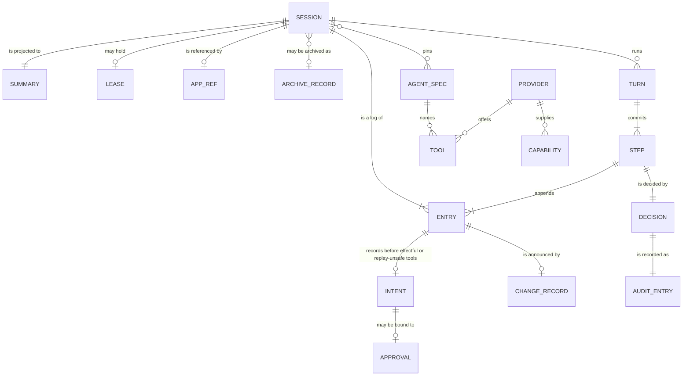
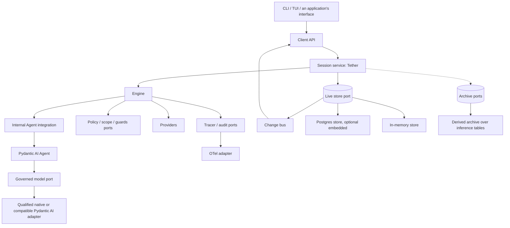

---
ddx:
  id: SD-001
  type: solution-design
  activity: design
  status: draft
  owner: Erik LaBianca
  updated: 2026-10-24
  authoring:
    home: repo
  links:
    - id: SPIKE-004
      kind: informed_by
    - id: SPIKE-003
      kind: informed_by
    - id: prd
      kind: informed_by
    - id: architecture
      kind: informed_by
    - id: ADR-001
      kind: informed_by
    - id: ADR-002
      kind: informed_by
    - id: ADR-003
      kind: informed_by
    - id: ADR-004
      kind: informed_by
    - id: ADR-005
      kind: informed_by
    - id: CONTRACT-001
      kind: informed_by
    - id: CONTRACT-002
      kind: informed_by
    - id: CONTRACT-003
      kind: informed_by
    - id: SPIKE-001
      kind: informed_by
    - id: SPIKE-002
      kind: informed_by
    - id: ADR-012
      kind: informed_by
    - id: ADR-013
      kind: informed_by
    - id: ADR-014
      kind: informed_by
    - id: ADR-015
      kind: informed_by
    - id: ADR-016
      kind: informed_by
    - id: ADR-017
      kind: informed_by
    - id: ADR-018
      kind: informed_by
    - id: ADR-019
      kind: informed_by
    - id: ADR-020
      kind: informed_by
    - id: ADR-021
      kind: informed_by
    - id: CONTRACT-004
      kind: informed_by
    - id: CONTRACT-005
      kind: informed_by
    - id: TP-001
      kind: informed_by
    - id: concerns
      kind: informed_by
---

# SD-001: The Tether Library Design and Build Plan

**Feature**: all subsystems of the [PRD](../../01-frame/prd.md) (feature specifications `FEAT-001` to `FEAT-012` are written in `frame`). **Artifact**: `docs/helix/02-design/solution-designs/SD-001-tether-library-design-and-build-plan.md`

## Scope

- Feature-level design for the whole library: the selected Agent runtime integration and invariant facade, the session service, the live stores and archives, the client API, telemetry, the test kit, and the reference clients, and the order in which they are built.
- Not in scope: story-level designs (technical designs per slice, written when a slice starts), the first downstream platform's adoption work, and any server adapter.
- Governing artifacts: the PRD, the architecture, ADR-001 to ADR-021, CONTRACT-001 to CONTRACT-005, SPIKE-001 through SPIKE-004, and `concerns.md`.

## Requirements Mapping

### Functional Requirements

| Requirement | Technical capability / owner | Qualification | Priority |
|---|---|---|---|
| FR-1 to FR-5, FR-38, FR-49 | Agent runner, governed ModelPort/native-compatible adapter, terminal/stream bounds and current identity | Q1/Q2 | P0 |
| FR-6 to FR-10, FR-42 | SDK typed tools behind Tether registry, normalization, provider/approval/intent/result gates | Q1/Q5 | P0 |
| FR-11 to FR-14, FR-16, FR-34, FR-40, FR-41 | Session journal/history, lease, create/send deduplication, archive/restore and recovery | Q4 | P0 |
| FR-15 | Destination-scoped source/reference fork | Store/history suites when delivered | P2 |
| FR-17 to FR-20, FR-48 | Owner-scoped Client, atomic snapshots, pending/effect commands and bounded follow/reconnect | Q6 | P0 |
| FR-21 | Measured Client budgets and regression baselines | Q6 | P1 |
| FR-22, FR-23, FR-25 | Content-free tracer/audit and complete/incomplete per-attempt usage | Q7 | P0 |
| FR-24 | Optional real OTel exporter | Q7 receiver proof | P1 |
| FR-26, FR-27 | Policy, retrieval, scope, provider and result-guard mediation with no-op dummies | Q1/Q3/Q7 | P0 |
| FR-28 | Public-port doubles/conformance, fabricated cassettes, deterministic replay and Agent regression harness | Q0/Q1/Q8 | P0 |
| FR-29, FR-30, FR-33 | CLI/TUI over Client; offline scripted Model and durable JSONL reference profile | Q0/Q4/Q6 | P0 |
| FR-31, FR-32, FR-36 | Selected slim runtime, qualified extras, license and contribution metadata | Q0/Q8 | P0 |
| FR-35, FR-45 | Source-addressed full/recent/summary context, estimators and governed auxiliary calls | Q3 | P0 |
| FR-37 | Opt-in recovery with explicitly supplied current identity | Q4 extension cases | P1 |
| FR-39, FR-43, FR-51 | Databricks profile, authoritative external model exchanges and writable supplement | Q9 | P1 |
| FR-44, FR-46 | Unknown-effect barrier and authorized manual resolution; target reconciler separately optional | Q1/Q4 | P0 (reconciler P1) |
| FR-47 | Actual synchronous-worker lifetime, capacity and replacement-work refusal | Q5 | P0 |
| FR-50, FR-52, FR-53 | HistoryProvider, local JSONL, verified SDK derivatives, physical attempts/receipts, bounded readiness and access control | Q2/Q3/Q4/Q6 | P0 |

### NFR Impact on Architecture

| NFR | Requirement | Architectural Impact | Design Decision |
|-----|------------|---------------------|-----------------|
| Concurrency | Many sessions, cancellation, no blocking | Async throughout; offload; structured task ownership by `Tether` | ADR-001 |
| Performance | Fast list, page, follow at scale | Summaries, keyset cursors, delta feed, bounded queues | ADR-004 |
| Reliability | No lost or duplicated committed step after a crash; no automatic rerun of an unsafe tool; an unknown outcome is explicit | Per-step atomic commit, lease with fencing, idempotent keys, intent before effect, the resume planner, declared store capabilities | ADR-005, ADR-010, ADR-014, ADR-019 |
| Provider independence | Provider-SDK-free public core/base with selected slim runtime; isolated optional provider SDK adapters; the Databricks gateway supported, never required | Port boundaries, qualified adapter extras, the Databricks profile | ADR-012, ADR-013 |
| Storage separation | Hot and cold needs met by different stores; a platform log usable as an archive | Live store and archive ports with capabilities | ADR-019, ADR-020 |
| Security | No content in telemetry; fail closed; engine invariants hold against a buggy extension | Content-free spans and audit, scrubbed adapter errors, gate order fixed by the engine, approval bound to an invocation, an explicit trust model | ADR-015, ADR-016, CONTRACT-002 sections 7 to 9 |
| Testability | Loop tested alone | Ports with dummies; cassettes; conformance suites | ADR-003 |

## Solution Approaches

### Approach 1: Concrete loop/store/client without replaceable boundaries

Rejected. It does not preserve the embedding, testability and policy/storage substitution requirements.

### Approach 2: Pydantic AI Agent with Tether invariant integration (selected)

Reuse iteration, typed dispatch/output, deferral, bounded correction and conversation bookkeeping. Reuse model/provider mapping through governed adapters. Tether owns current policy, stable invocation/approval bindings, commit/frontier decisions, source history, recovery and Client behavior. SPIKE-003/004 establish public integration seams; the remaining qualification is listed below. Integration/version maintenance remains real work, but the tested adapter defects were corrected without another loop.

### Approach 3: Owned execution loop with direct or owned model clients

Not selected. A direct model API can remove transport work, but an owned driver would still duplicate Agent iteration/dispatch/state machinery. No functional necessity or measured complexity advantage has been demonstrated. Revisit only on a concrete failed requirement or total-maintenance case through ADR-003; do not build this as a parallel hedge.

**Selected Approach**: Approach 2 under accepted ADR-002/003. pydantic-ai-slim is the provider-neutral runtime dependency; native provider SDKs remain selected optional extras under ADR-012. This is the implementation direction, not a claim that every production profile is qualified. Harness context/store components are independently assessed; no whole-Harness adoption or second recovery ledger is selected.

## Domain Model

### Business Rules
1. **One decision point**: every model call, tool call, retrieval, engagement, and widening is decided by the policy port and recorded, allowed or denied.
2. **Gates are the engine's**: a provider narrows (refuses, hides, redacts) and never widens; a failing hook closes.
3. **A step is one commit**: its entries, the summary update, and the change records are atomic before the next step starts, and durable on a store that declares durability.
4. **The log is the truth**: summaries and the feed are projections that cannot disagree with it.
5. **One turn per session**: a lease with a heartbeat enforces it; an expired lease is an interrupted turn.
6. **Content stays out of telemetry**: spans and audit entries carry identifiers, sizes, and reasons.
7. **The core reads no environment**: an application builds configuration and passes it in.
8. **Intent before effect**: every effectful or replay-unsafe tool records intent before dispatch; an unknown effect blocks new effectful invocations. Recovery may retry a replay-safe invocation only under its original id and unchanged digest, through current gates.
9. **An approval is bound**: to one invocation, its arguments, and its tool definition; it satisfies only the approval gate.
10. **One owner per kind of state**: the application holds a reference to a session and never a second transcript (ADR-018).
11. **Archiving is off the turn path**: a derived archive is read-only, partial, and reports pending, denied, or unavailable, never empty.

## System Decomposition

### Component: Types and ports
- **Purpose**: The payload types and the `Protocol` classes every other component builds on.
- **Responsibilities**: Frozen, validated models; the port definitions; no I/O.
- **Requirements Addressed**: FR-2, FR-6, FR-11, FR-17 to FR-20, FR-26
- **Interfaces**: CONTRACT-001 to CONTRACT-003.
- **Owned by TDs**: Slices 1 to 3.

### Component: Model adapters and doubles
- **Purpose**: Implementations of the model port.
- **Responsibilities**: The selected Pydantic AI native/compatible model adapter behind ModelPort; shared runtime codecs, strict terminal/wire limits, current identity, physical attempt tags/receipts and scrubbed errors. The compatible profile configures this integration; it does not build another HTTPX protocol parser. Custom Model integration is reserved for demonstrated adapter gaps. Scripted/recording/replay doubles remain provider-free.
- **Requirements Addressed**: FR-2 to FR-5, FR-28
- **Interfaces**: CONTRACT-001.
- **Owned by TDs**: Slice 1.

### Component: Engine
- **Purpose**: Enforces Tether invariants around the selected Agent runner.
- **Responsibilities**: Tether-owned callbacks implement spec/policy/context/provider/guard order, normalized approval bindings, intent/result acceptance, unknown-effect barriers and recovery decisions. tether.runtime.pydantic_ai supplies public Agent execution and shared SDK codecs with fixed trusted capabilities. No general-purpose graph is reimplemented. Worker accounting remains Tether integration; CONTRACT-004 separates source-addressed context planning from execution authority.
- **Requirements Addressed**: FR-1, FR-6 to FR-10, FR-22 to FR-27, FR-34, FR-42
- **Interfaces**: CONTRACT-002.
- **Owned by TDs**: Slices 2 and 7.

### Component: Session service
- **Purpose**: The session log's owner in the process, and the live change feed.
- **Responsibilities**: Turn tasks, the lease and recovery, summaries, the change bus, idempotent create and send, `Tether`, `InMemoryStore`, `InMemoryArchive`.
- **Requirements Addressed**: FR-11 to FR-14, FR-16, FR-19, FR-34, FR-41
- **Interfaces**: CONTRACT-003.
- **Owned by TDs**: Slices 3 and 9.

### Component: Live stores and archives
- **Purpose**: Persistence behind the two storage ports, each declaring its capabilities.
- **Responsibilities**: Local JSONL journal/history and in-memory doubles; Postgres transactions/leases/feed and optional embedded server; optional SQLite; reference-complete archive/restore and supplemental legacy import. GatewayHistory is authoritative external exchange content, not the archive or execution authority.
- **Requirements Addressed**: FR-16, FR-40, FR-43
- **Interfaces**: CONTRACT-003 sections 3 and 4.
- **Owned by TDs**: Slices 5 and 11.

### Component: Client API
- **Purpose**: The UI boundary.
- **Responsibilities**: List, get, entries, follow, commands; the benchmark suite.
- **Requirements Addressed**: FR-17 to FR-21
- **Interfaces**: CONTRACT-003 section 5.
- **Owned by TDs**: Slice 4.

### Component: Telemetry
- **Purpose**: Spans, audit entries, and usage.
- **Responsibilities**: The tracer and audit ports, the OTel adapter, the content test.
- **Requirements Addressed**: FR-22 to FR-25
- **Interfaces**: CONTRACT-002 section 6.
- **Owned by TDs**: Slice 6.

### Component: Test kit
- **Purpose**: A dummy for every port, the conformance suites, cassettes, the replay driver, and benchmarks.
- **Requirements Addressed**: FR-28
- **Owned by TDs**: Slices 1 to 6.

### Component: Reference clients
- **Purpose**: A command-line client and a terminal UI for development and testing.
- **Requirements Addressed**: FR-29, FR-30
- **Owned by TDs**: Slice 8.

### Component Interactions

## Technology Rationale

| Layer | Choice | Why | Alternatives Rejected |
|-------|--------|-----|----------------------|
| Language | Python 3.11 and later | Direct embedding of Python tools and application objects; browser transport stays in the existing application (ADR-003) | TypeScript harness or dual runtimes; accept the cross-language browser contract |
| Models and ports | `pydantic` v2 frozen models, `typing.Protocol` | Validation and JSON Schema for tools; structural typing for ports that tests implement | Dataclasses (no validation); abstract base classes |
| Concurrency | `asyncio` with `anyio` for offload and cancellation scopes | ADR-001 | Threads per turn; a sync and an async twin |
| Runner/model integration | Pydantic AI Agent and model reuse behind Tether contracts | ADR-002/003/012; SPIKE-003/004 public boundary evidence | Owned loop/default HTTPX client not selected; qualify release profiles and closures |
| Stores | Local JSONL execution journal plus JsonlHistory by default; in-memory for explicit volatile use; optional Postgres for multiple processes, SQLite optional | Separate execution/content authorities and qualified durability profiles (ADR-018/019/020, CONTRACT-003/005) | SQLite as the only durable store; a server database with no embedded option |
| Packaging | One distribution with extras, `uv`, `hatchling` with `uv-dynamic-versioning` | The `python-uv` concern; one install for users | Several distributions (premature) |
| Boundary gate | `scripts/check_layers.py` and a clean-environment run | A repository script and an undeclared-import test | A third-party import checker |

### Application integration boundary

Retain the existing Databricks Apps server and its UI transport. The library exposes `Client` to that process; it does not add an AgentKit server, another supervisor, or a second TypeScript implementation. No AgentKit integration or comparative-wrapper experiment is a release dependency. Revisit adoption only through the concrete replacement/deletion criterion in ADR-003.

## Staged Build Plan

Agent is selected. Deliver one runtime integration; do not schedule an owned loop, parallel runner comparison or default owned HTTPX client. The SPIKE-004 fixtures are regression seeds and executable evidence, not production store/codec implementations. Port only inspected/scrubbed reusable behavior and its tests; a downstream application's characterization scenarios constrain parity, not runner ownership.

Journal facts, source history and derived SDK state remain separate. Local JSONL is the reference durable default; generic history/readiness/correlation is P0. Gateway profile delivery/live qualification remains P1. Basic authorization, approval and intent-before-effect apply from the first executable tool path, including demos; later slices qualify those guarantees rather than introduce them late.

Each slice leaves a buildable/tested subset. Support claims name the actual qualified version/profile. Release 0.1 requires every P0 acceptance gate; a selected optional extra cannot claim support until its profile gate passes.

| Slice | Does | Verifiable outcome / dependencies |
|---|---|---|
| 0. Scaffold and runtime lock | Packaging/typing/lint/CI/licenses, selected slim dependency and named import boundaries; AGENTS.md aligned with ADR-002/003/012. Scaffold implementation and bounded Q0 evidence: [execution record](../evidence/slice-0-execution-20261023.json) | Q0: clean base, offline imports/demo path, forbidden-import negative controls; exact lock and Python matrix recorded |
| 1. Agent/model integration and doubles | Runtime bridge/shared codecs, Tether ModelPort integration, qualified Pydantic native-compatible adapter, scripted/recording/replay doubles | Q1/Q2 foundation: no vendor types escape; strict terminal/structure limits before tools; every real attempt mediated; no owned protocol stack |
| 2. Gated tool execution | Tether registry/providers/policy, normalized validation/approval, guard/result/intent callbacks and fixed serial Agent composition | Q1: characterization scenarios and SPIKE-004 regressions; denied/failed/unknown commits prevent dependent dispatch. Volatile doubles make no restart claim |
| 3. Session and local history foundations | In-memory doubles plus local JSONL journal/history, references, accepted SDK checkpoint codecs, summary/feed atomicity, lease, deduplication and archive/restore | Q3/Q4 foundation: originals and derivative state stay distinct; lifecycle/projection consistency; never adopt fixture files as production storage |
| 4. Client API | List/page/history/call_detail/effects, atomic snapshot/follow, pending approval, confirm/cancel/close/update/resolve | Q6 owner/read-policy/race/retention/bounds suites; initial workload baselines, proposed budgets explicit |
| 5. Postgres profile | Production transactions, leases/fencing/feed, pool/migrations and optional embedded server | Q4 required multiprocess profile: cross-process takeover, stale writes, unknown acknowledgments and restart; explicit embedded startup measurements |
| 6. Telemetry and usage | Metadata-only tracer/audit/no-op default, per-attempt/purpose usage, optional OTel adapter | Q7: no prompt/tool/credential leakage, missing usage preserved; exporter claims require real receiver proof |
| 7. Governance extensions | Scope binding, spec resolution, narrow-only providers, result guards and optional heuristic packages | Q1/Q3: failure/refusal/mutation/definition/READ_SESSION matrix and no bypass through SDK capability composition |
| 8. Reference clients | Standard-library CLI and Textual TUI over Client, provider-free scripted model, durable local JSONL reference demo | Q0/Q4/Q6: installed offline journeys, readable approval/unknown/context exhaustion, pseudo-terminal UI, timed quickstart; depends on qualified local storage before durability claims |
| 9. Recovery and actual workers | Journal-derived interrupted-state planner feeding Agent, immutable intent reuse, unknown barrier/manual resolution, bounded resume chains and actual executor lifetime | Q4/Q5: unsafe non-idempotent effects never replay automatically, safe attempts reuse original id/digests, worker exit retains capacity/session busy, bounded shutdown and no stale callbacks |
| 9a. Context and stream/outcome qualification | Full/Tail/SummarizingContext through source-addressed validation, estimators and governed summary model calls; selected streaming profile | Q2/Q3: complete/protected coverage, no altered raw proposals, full payload fit, summary failure/commit/restart matrix, provisional reset and terminal fragmentation/cancellation |
| 9b. History and attempt qualification | Production JSONL file fault tests, immutable codecs/hashes/links, physical recorder, controlled external-source delay/denial/partial/ambiguity | Q2/Q3/Q4: content-before-ref, torn/unknown writes, index rebuild, multiple invocations/receipts, owner/current read checks and unavailable-source restart behavior. Live Gateway delivery stays slice 11 |
| 10. Release 0.1 | Installed artifact/docs, license/contribution metadata, consumer parity and declared support matrix | All P0 gates below pass; profile/version/subset evidence retained. No unsupported native/optional integration is implied by the Agent choice |
| 11. Gateway profile (P1) | Databricks route/tier/current identity, exact tag/header/invocation mapping, caller-authorized GatewayHistory plus writable supplement | Q9 live fabricated evidence, bounded SQL/retention/access/readiness behavior; no denied caller fallback and no row-derived execution authority |
| 12. Target reconcilers (P1) | Optional read-only tool-specific evidence adapters over existing manual resolve | Q4 target-specific proof; reconciliation never dispatches a tool or bypasses the effect barrier |

Slice 1 implementation and scoped qualification are recorded in [the execution record](../evidence/slice-1-execution-20261023.json).
It covers the actual Agent bridge, ModelPort doubles/codecs and the native compatible text/tool
subset over fabricated HTTPX2 transports. That slice did not complete Q1/Q2/Q3: gated dispatch,
correction/structured-output paths, durable source/checkpoint binding, streaming and live profile
proof remain assigned to the slices above. No alternate runner is selected.

Slice 2 implementation and bounded qualification are recorded in [its execution record](../evidence/slice-2-execution-20261023.json).
The actual Agent now uses Tether's pinned registry, normalized argument/source bindings,
current policy/provider/approval/guard gates and acknowledged intent/result commits. Serial
batches stop at pending approval; continuation uses Agent's public deferred API and re-enters
the gates. Volatile journal and message-history subsets support fabricated faults, not restart
or fenced-store guarantees. Full HistoryProvider readiness/exchanges, durable approval recovery,
safe same-invocation recovery/manual resolution, scope/spec resolver integration and telemetry
remain assigned to later slices. No integration finding justifies an alternate runner.

**Characterization scenarios (slice 2)**: plain answer; allowed/denied/scope-required tool; invalid arguments; typed failure; step limit; model denial/outage/cancellation; approval approved/declined/expired/superseded; always-ask tool; result guard refusal; narrow-only hidden/redacted provider output; failing hook; current read revocation. Add digest/default/coercion changes, forged SDK success, invalid terminals and uncertain commit regressions from SPIKE-004.

Slice 3 implementation and bounded qualification are recorded in [its execution record](../evidence/slice-3-execution-20261023.json).
Local JSONL journal/history now provide checksummed batches, accepted-prefix witnesses, owner-scoped
projections, in-writer lease fencing, archive closure and pending-approval reconstruction through
Agent from current authorized originals and supplied pinned specs. File faults and process exit
are qualified locally; actual power-cut behavior, multiprocess Postgres, full Client, manual effect
resolution and complete started-invocation recovery remain later work. No cached SDK state is
authority and no finding requires a second loop.

Slice 4 is in progress. Its versioned owner/principal, payload-read and loop-affinity
prerequisites and shared store query/update/effect/feed surfaces have local execution evidence
in [the release execution record](../evidence/release-execution-20261023.json). This does not
complete the full Client API. Owner-bound metadata/history/physical-attempt/pending reads now
use current authorization, verified history and finite explicit limits. Aggregate payload
permission is rechecked before disclosure; denial preserves receipts and redacts all raw
observations. Async composition enforces loop affinity, rejects weaker/unqualified recovery
history and retains root ownership until actual workers exit. SDK instrumentation is explicitly
disabled against ambient `Agent.instrument_all` configuration. Persisted follow now has bounded
independent replay workers, owner watermark capture, per-variant current policy, whole-commit
markers and retained-window reset. Shutdown wakes idle followers and handles canceled/timed-out
follower cleanup. Client send/cancel now run as bounded Tether-owned tasks, return after atomic
acceptance, and shield the task from consumer-wait cancellation. Canonical request retries are
checked again under the lease; completed/restarted outcomes come from current authorized
originals and pending inspection, not cached task content. A finite read deadline begins after
execution. Lease heartbeats are supervised and stopped cooperatively so in-flight journal writes
finish before lease release; bounded shutdown retains ownership through deferred cleanup.
Real root/composition restart retries, stale handle cancellation and post-acceptance setup failure
have source regressions. External active-turn result following remains unqualified; selected
local recovery reports interrupted state, and result lookup without a local task refuses a still
running turn. Client confirmation now checks journal pending facts before cached Run state,
accepts decisions and the running projection atomically, and returns a shielded owned handle
before fallible continuation. Continuing requests refresh current principal/credential; the
logical turn count is unchanged. Late/concurrent answers cannot repeat execution. Retained
successful send handles follow an accepted continuation; journal result lookup refuses an old
terminal while a newer continuation is running. Informational approval notes are bounded
immutable history outside executable inputs, audit text and automatic model input. Client create/update now use bounded copied owner-scoped requests,
reference-idempotent creation, store-owned lease serialization and current read authorization.
Title omission preserves the value; explicit None clears it. Public settings cannot replace
binder-managed held context; governed binding remains a separate extension seam.
Client close now seals incomplete/pending groups and commits closure atomically after content
preparation and current policy checks. It refuses active turns, actual live workers and unresolved
effects, with repeat-close idempotency and closed-session read access. Cancellation projects as
idle/nonresumable, distinct from interruption (ADR-010). Manual resolution now records authorized operator outcomes under the lease without dispatch,
closes missing terminal results as unknown, preserves original evidence, clears the indexed barrier
atomically and rejects conflicting decisions or malformed partial-group refs. Identical retries
remain authorized and mutation-free, including after close/reopen. Volatile history now verifies
the same scoped refs as durable profiles. Resume and remaining command race qualification stay
in this slice; provisional text/reset/coalescing remain slice 9a. The Agent remains the only
model/tool iterator. Full qualification status is in the execution record.

The slice 9 pure recovery planner now classifies journal-derived not-started, started-safe,
started-unsafe, finished and resolved invocations using explicit owning session identity and
immutable tool digest/replay snapshots. It validates dense positions, source scope and interrupted
ancestry, refuses cancellation/supersession crossings, and never hydrates or dispatches. A matching
accepted final-answer source can avoid another model step, subject to executor source verification.
This is planner evidence only. Client/Engine resume acceptance, chain-limit enforcement, safe
same-intent dispatch, pending-approval rebinding, budget reconstruction and actual Agent restart
journeys remain required before claiming runtime resume or completing slices 4/9. Consumer recovery
entry seams were inspected; no tested standalone planner was available to port.

### Consumer boundary review and implementation plan

The consumer integration review identifies missing extension seams, not a reason to replace
Agent or import an application's workflow into core. Apply ADR-017's membership test and
ADR-018's state ownership. The feedback's pre-implementation baseline does not describe the
current source; individual asks still need contract and executable qualification.

This is a plan for contract amendments and implementation. Proposed seams below are not
current API guarantees. Before their implementation, amend the named contracts and governing
architecture/ADRs where necessary; then add a dummy, conformance cases and failure evidence.
Existing release priorities stand unless a requirement is explicitly promoted. An adoption
blocker for one consumer is distinct from a universal release blocker.

| Ask | Boundary and minimum work | Sequence / qualification |
|---|---|---|
| Distinct session owner and model principal | Core identity binding; retain owner/policy subject and explicit caller credentials, allow separately verified model principal; no persona model | Before slice 4: CONTRACT-001/002/003; distinct owner/principal and concurrent credential tests |
| Event-loop affinity | Core lifecycle; bind async composition to one running loop; thread bridges submit to it, never reuse async pools across loops | Before slice 4: CONTRACT-003; wrong-loop refusal and bounded close |
| Payload-specific permission | Core read boundary; exchange payload disclosure needs additional current authorization while metadata remains independently readable; reachable refs and owner checks remain mandatory | Slice 4: CONTRACT-002/003/005; metadata allowed/payload denied, revoked reads and archive closure tests; decide original transcript distinction explicitly |
| Client-origin tool invocation | Generic command through the same lease, validation, policy, source binding and intent/result path; no model call; approval-required refuses | Define in CONTRACT-002/003 before slice 4, implement by slice 7; no bypass or fabricated model provenance |
| Leased preparation | Bounded async seam before first model request, after accepted-input deduplication; application prepares attachments and domain state | Slices 4/7: CONTRACT-002/003; cancellation, lease loss, retry and changed-input tests; accepted text/attachment identity cannot mutate silently |
| Edited approval | Optional trusted argument-transform seam; preserve proposal, shown values and exact executable values with independent digests and renewed gates | Slice 7: CONTRACT-002; semantic restriction belongs to tool/provider; structural JSON subset is no safety proof |
| Batch approval | Optional bounded command convenience, independent single-use invocation bindings and serial execution | Adoption enhancement; existing serial answers cover demonstrated consumer behavior; concurrent/partial answer races before claiming support |
| Staged application writes | Generic durable settlement seam; application owns participant semantics, content and retention | Slices 5/7/9: CONTRACT-002/003; durable decision plus idempotent reconciliation or selected same-transaction participant; crash at every frontier |
| Explicit spec transitions | Generic authorized transition between completed call groups; application owns engagement/routing | Slice 7: CONTRACT-002/004; pin digest/version, close/refuse outstanding old-spec calls and invalidate incompatible approvals |
| Runtime registry publication | Immutable generation snapshots, atomic publication and pinned active invocations; policy revocation remains current | Slice 7: CONTRACT-002; replace/remove during execution and pending approval. Existing hidden-tools seam handles visibility within a registered superset |
| Auxiliary model calls | Mediated purpose/profile calls using current read/model policy, caller identity, attempt and usage journal | Slices 7/9a: CONTRACT-001/002/004; application schedules naming/suggestions; no mandatory suggestion field or job service |
| Postgres authoritative history | Optional paired PostgresHistory/SessionStore implementing separate ports; content-before-ref across backends, optional shared transaction profile | Slice 5: CONTRACT-003/005; atomic rejection/unknown acknowledgment and exact history binding evidence |
| Schema and migrations | Postgres adapter owns configurable validated schema, version checks and exportable SQL; application chooses migration tooling | Slice 5: explicit migration invocation, no migration during ordinary client construction; decide and qualify an optional plain-SQL profile excluding stored functions, triggers and PL/pgSQL |
| Scoped database connections | Adapter connection-acquisition seam with verified actor/session context | Slice 5: application owns pools, credentials and RLS; keep owner predicates, no broader-role fallback |
| Cross-process live text | Optional bounded live transport beside authoritative persisted feed | Slice 5: declare cross-process capability, dropped events/polling fallback; notifications are not durable history. Immediate live parity remains an adoption decision |
| Summary business facets | Application bulk enrichment and existing refs/tags first; optional indexed facets require explicit schema/filter/bounds contract | Later enhancement; no arbitrary business records in SessionState or shadow transcript |
| Replace last turn | Optional immutable retraction/projection feature; no deletion of intents, approvals or effects | Later scope decision; refuse unresolved effects; application owns upload cleanup |
| Existing-session import | Optional bounded import with original provenance | Cutover enhancement; imported pending approval/effect facts never become newly executable authority |
| Defaults package | Composition convenience with finite limits and deterministic estimator | Slices 8/10: explicit selected model limits; do not invent provider capacity |
| Release/distribution | Packaging and versioned support matrix, artifact hashes and selected release channel | Slice 10: installed wheel/sdist journeys; signing/publishing require selected authority and profile, not assumed credentials |
| Telemetry naming | Existing configurable prefix/namespaced events plus application adapter | Slice 6: preserve canonical semantics and metadata-only sinks; receiver proof for exporter claims |
| Gateway parity | Optional model/history enrichment profile using selected native-client integration | Slice 11 P1: caller-only identity, exact correlation and live fabricated qualification; gateway logs are not the whole original transcript |

**Settlement invariant to design before implementation:** an ordinary callback before the
result commit can leave an application effect committed with an unknown journal outcome;
a callback after the commit can expose success before that effect exists. Do not describe
either as atomic settlement. A shared-database profile may enlist a bounded participant in
the fenced transaction without exposing a raw connection through generic ToolContext. An
independent-backend profile needs durable stage ids, recorded settlement decisions, idempotent
commit/rollback/reconciliation and explicit uncertainty blocking dependent actions. Browser
delivery cannot be part of a database atomicity guarantee.

**Factual documentation corrections before dependent work:** remove the non-normative
CONTRACT-003 description that implies an existing consumer stores only keys/facts and
reconstructs its original transcript from gateway logs. Correct the discovery assessment's
stale derived-archive/content-by-reference deferral against ADR-018/019 and CONTRACT-005.
Describe RLS as deployment-selected qualification, not an established consumer feature.
Preserve external exchange history as a valid optional profile; do not copy private consumer
implementation details into the public explanation.

**Qualification additions:** use fabricated scenarios for owner/principal separation, edited
argument digests, single-winner answers, registry replacement/revocation, preparation replay
and cancellation, auxiliary calls after closure, metadata/payload permission splits,
settlement crashes and two-process follow with lost live events. Reuse inspected and scrubbed
consumer characterization tests where they test generic behavior; keep its business records,
transport, domain labels, uploads and workflow routing in the application adapter.

**Decisions still owned by the product owner:** whether rewind/import/batch approval are
mandatory for initial cutover; immediate cross-process deltas versus committed-result fallback;
which application settlement profile is required; original transcript versus exchange payload
permissions; release channel/signing authority. These do not block independent slice 3 storage
qualification. They must be explicit before a dependent support claim, rather than silently
promoting every integration request to P0.

### Remaining qualification work

The owner has selected Agent. The entries below qualify production behavior and support claims, rather than reopen that choice. Role ownership identifies who implements/proves a boundary, not a separate team or service. Q0-Q8 cover applicable P0 acceptance; OTel exporter, performance commitment, automatic recovery and optional profiles retain PRD P1 scope. Q9 is Gateway P1.

| Gate | Primary owner / slices | Evidence required before claiming support | Current evidence and release scope |
|---|---|---|---|
| Q0: Runtime/packaging boundary | Runtime/packaging; 0, 1, 8, 10 | Clean slim-only base closure and all selected extras; typed public APIs, lazy optional imports, explicit configuration, offline demo, license notices and Python/OS matrix | No clean-install release audit yet. Seed SDK/Graph 2.59.0 + Pydantic 2.14.1 / Python 3.11.17; pin/qualify shipped versions. Base gate P0 |
| Q1: Agent tools/gates/state integration | Invariant facade/runtime; 1, 2, 7, 9 | Production registry/schema codecs, ordered policy/provider/approval/guard path, current reads, exact normalized dispatch, duplicate/changed/stale/unknown-commit controls, fixed capability composition and sequential batches | Slice 2 adds actual serial Agent dispatch, normalized/default/serializer bindings, approval lifecycle, guards/narrowing, source revocation and rejected/unknown commit regressions. Volatile subset only; durable recovery and full schema/content coverage remain. P0 |
| Q2: Model/transport/stream | Model integration; 1, 9a, 9b | At least the required non-Databricks compatible profile: final wire digest/tags, every SDK retry/fallback/continuation, current identity, distinct receipts, malformed/fragmented/terminal outcomes, cancellation/backoff/deadline and usage completeness | Custom nonstreaming MockTransport only. Native Claude/other installed extras require their own evidence before support; no new loop follows from a transport gap. Required compatible behavior P0 |
| Q3: Context/history codecs | Context/history/runtime; 3, 7, 9a, 9b | Full source coverage/order/protection, all history readiness states, canonical digests/links, source access/revocation, versioned SDK conversion preserving supported provider extension/reasoning/cache/media content or explicitly refusing unsupported codecs, source-bounded summaries through governed ModelPort, final complete-payload estimates and crash/failed-summary behavior | Source/cache binding and basic compaction separation exercised; primitive converter is not full context/media coverage. P0 |
| Q4: Durable stores/recovery | Sessions/stores/history; 3, 5, 9, 9b | Local JSONL and required multiprocess Postgres suites: atomic entries/summary/feed, content-before-ref, rejected/unknown/torn writes, fencing/index rebuild, lifecycle/archive closure, lost checkpoint reconstruction, mixed call groups, resolve races and unsafe/safe process/storage faults | Five process exits on the fixture are not production store or all-frontier recovery proof. Auto-resume/reconcilers retain P1 extensions. Core durability/manual resolve P0 |
| Q5: Actual worker lifetime | Execution/offload; 2, 9 | Real blocking sync tool, cancellation/timeout/lease loss, queued cancellation, permits/session-busy until actual exit, stale writes/completion and finite shutdown | Slice 2 exercises blocking sync cancellation, retained capacity/session-busy, queued cancellation, copied context and finite shutdown. Lease loss, process faults and production lifecycle remain unqualified. P0 |
| Q6: Client and reference journeys | Sessions/Client/CLI/TUI; 4, 8, 10 | Owner-scoped lists without content scans, bounded pages/detail, atomic snapshot/watermark, reconnect/reset/retention/backpressure, close/confirm/resolve races, revocation-safe preview, durable installed demo and consumer parity | Not a complete Client implementation in the spike. Functional journeys P0; measured performance commitment P1 |
| Q7: Telemetry/usage | Runtime/telemetry; 6 | Metadata-only errors/spans/gate audit, credentials absent from every content/cassette/diagnostic record, real trace context, no default content instrumentation, known/incomplete usage once per attempt/purpose | Mock credential isolation/usage observations are partial. Base behavior P0; optional exporter needs separate real receiver proof (P1) |
| Q8: Upgrade/replay regression | Runtime/test kit; 0, 1, 10 | Versioned checkpoint/message codecs; unsupported versions explicit; fabricated cassette/response drift; rerun gate/source/effect/attempt tests for each SDK/Graph/Pydantic pin change; no private graph imports | 2.59.0 baseline only; no general upgrade guarantee. Release-selected version P0 |
| Q9: Gateway source profile | Gateway model/history integration; 11 | Live fabricated header/tag/body/request/invocation correspondence, distinct component/full-record hashes, bounded current-caller reads, retention/lag/duplicates/partial/revocation, supplement and no guessed effects | No live Gateway join qualified. P1; cannot claim the optional extra supported until passed |

Every qualification receipt names exact code/dependency/profile versions, selected capabilities, fault point, fabricated scenario, observed effect/dispatch counts, outcome and capture limits. Rejected or missing proof blocks that support claim; fixture checks are not promoted to full conformance. Failure should first be addressed in the adapter/integration. A runner replacement requires the explicit ADR-003 revision criterion.

### Framework review verification

ADR-003 selects Agent. The [framework review](../../00-discover/agent-harness-framework-review.md#current-disposition-after-coordinated-design-reconciliation) informed the alternatives; SPIKE-004 is bounded execution evidence. The following cases remain production acceptance work and map to Q1-Q8, rather than selecting another runner. All inputs, identities, documents, and effects are fabricated.

| Case | Requirement / finding | Primary owner and slice | Proposed acceptance evidence |
|---|---|---|---|
| V-H1. Unsafe effect completes before result commit | FR-14/34/42; H1 | Engine and durable store, slice 9 | A separate process records an observable fabricated effect, then is killed before result append. Intent survives, outcome is unknown, resume never automatically reruns that invocation, and committed entries/summary/feed agree |
| V-H1b. Fresh model call repeats an unresolved effect | FR-42/44; H1 | Engine/policy design before slice 9; reconcile in slice 12 | Model emits an equivalent unsafe action with a new call ID after timeout/error/unknown. Demonstrate the session-wide effectful-call barrier across new ids, arguments and tool names; only authorized recorded resolution clears it, and a new approval alone cannot |
| V-H2. Synchronous tool outlives cancellation | FR-6/20/42; H2 | Engine/offload and durable store, slices 2/5/9 | Block a real worker-thread tool on a controlled barrier, cancel or expire its lease, start a contender, then release the old tool. Show stale writes are rejected and external-effect uncertainty is preserved; prove a permit remains occupied until actual worker exit, queued work can be cancelled, local replacement turns/resolve are refused and shutdown is deadline-bounded |
| V-H3. Approval races and compatibility | FR-8/20/42; H3 | Engine/client, slices 2/4/9 | Duplicate answers have one winner; changed actor rights, arguments or tool digests refuse execution; restart between approval and intent preserves valid approval without skipping authorization |
| V-M1. Bounds and absent usage | FR-1/5/25/26; M1 | Model adapter, engine/policy, slices 1/2/7 | Configured tool/hook deadlines and step limits work; configured policy handles missing usage explicitly. Oversized request/tool output and retry exhaustion follow an explicitly selected adapter/application policy; no inferred zero usage or stacked retries |
| V-M2. Small context and long history | FR-35/38; M2 | Context/history strategy and engine; P0 CONTRACT-004/005 | Configure a small-context local-server profile; retain authoritative history while bounding model input. Pending tool pairs, approvals and unknown outcomes survive any selected redaction/compaction. Qualify the selected bound/overflow policy and source availability; never infer original history from a later model prompt |
| V-M3. Failure-point matrix | FR-14/28/34/42; M3 | Engine and store test kit, slice 9 | Inject failure before intent, after intent/before dispatch, after external effect, during result normalization, before/after commit, and before notification. Cover ordered mixed safe/unsafe batches; log-prefix property tests supplement these execution tests |
| V-M3b. Replay and stochastic task quality | FR-28/38; M3 | Test kit, slices 1/2 and application qualification | Fixed-response replay reproduces runtime decisions and reports request drift. Separately grade fabricated research, extraction and approved-action outcomes across named server/model profiles; report repeated-trial results without treating replay as model-quality evidence |
| V-M4. Dependency boundaries | FR-31/38; NFR-8; M4 | Packaging and adapter owners, slices 0/1 | A clean base install has no provider SDK imports or transitive dependencies; selected optional adapters disclose and qualify their closure. A later optional adapter must qualify its own exact dependency closure before support is claimed; Agent is selected; the release runtime/extra closure is checked under Q0 |
| V-CLIENT. Identity and reconnect | FR-4/17–20; NFR-4/6 | Client/store and telemetry, slices 4/5/6 | Two concurrent actors retain separate credentials, reconnect from persisted positions, and recover authoritative changes while slow readers stay bounded; no prompt, tool-content or credential marker appears in operational telemetry |

**Governing execution boundaries.** CONTRACT-002 and ADR-001/014 specify the session-wide effectful-call barrier, authorized manual resolution, actual worker permit lifetime and local replacement-work refusal. These close H1/H2 at design level; V-H1/V-H2 remain required execution evidence. The application still supplies cross-session business idempotency and downstream fencing. Optional P1 reconcilers do not replace P0 manual resolution or authorize an automatic new effect.

**Sequencing.** Approval enforcement, current authorization and pre-effect intent are required whenever an effectful or replay-unsafe tool is dispatched, including characterization/demo paths. Later slices add production storage and fault qualification; they do not authorize an earlier path to bypass those gates. Context projection/compaction and full model request bounds are P0 under CONTRACT-004; configurable usage/cost thresholds remain application policy. The numeric performance targets remain proposals until measured.

**Evidence closeout.** A qualification run should record the source/artifact versions, selected store capabilities, configured deadlines/context policy, fabricated scenario IDs, model/server profile when applicable, fault point, observed effects and recovery state, verification result, and capture limits. OTel claims additionally need a real receiver/export correlation check under the selected diagnostics practice; console silence and no-op tracers prove no exporter integration. Store operational evidence separately from content-bearing fabricated eval fixtures. No comparative framework benchmark is required; selected optional extras require their own installed closure and behavioral qualification before support is claimed.

## Traceability

The functional mapping above is the release-scope index for all 53 stable FRs; qualification IDs map their design owners to the primary proving work below. Exact interfaces stay in the contracts.

| Requirements | Component / contract | Test strategy |
|---|---|---|
| FR-1 to FR-5, FR-38, FR-49 | Runtime/model integration; CONTRACT-001/002/005 | Q1/Q2 adapter, wire, stream, identity and terminal suites |
| FR-6 to FR-10, FR-26, FR-27, FR-42, FR-44, FR-46, FR-47 | Facade/tool integration; CONTRACT-002 | Q1/Q4/Q5 normalized gates, approval/effects, failure/worker/recovery tests |
| FR-11 to FR-16, FR-34, FR-37, FR-40, FR-41 | Sessions/stores; CONTRACT-003/005 | Q4 durable lifecycle/idempotency/archive/resume tests; fork P2 and auto-resume P1 |
| FR-17 to FR-21, FR-48 | Client/session service; CONTRACT-003 | Q6 owner-scoped pages, atomic snapshot/feed, commands, bounds and benchmark baseline |
| FR-22 to FR-25 | Runtime/telemetry; CONTRACT-002/005 | Q7 metadata-only audit, usage and optional real OTel receiver |
| FR-28 | Public-port/runtime test kit; CONTRACT-001 through CONTRACT-005 | Q0/Q1/Q8 dummies, conformance, fabricated replay and upgrade failures |
| FR-29, FR-30, FR-33 | Reference CLI/TUI; CONTRACT-003 | Q0/Q4/Q6 installed offline/durable/pseudo-terminal journeys |
| FR-31, FR-32, FR-36 | Packaging and contributions; ADR-003/006/007/012 | Q0/Q8 clean base/extras, license texts, contribution and release matrix |
| FR-35, FR-45, FR-50, FR-52, FR-53 | Context/history/model integration; CONTRACT-004/005 | Q2/Q3/Q4/Q6 coverage/codec/readiness/attempt/hash/current-source and restart tests |
| FR-39, FR-43, FR-51 | Optional Gateway profile/history; ADR-013 and CONTRACT-005 | Q9 fabricated live profile evidence (P1) |

### Gaps
- [ ] Feature specifications and user stories are not yet written; `frame` writes them and maps each FR to a story.
- [ ] The performance numbers are proposals (NFR-7); the first baseline validates or replaces them.
- [ ] Complete Q0-Q8 for every required release capability/profile; retain explicit subset/version evidence.
- [ ] Complete Q9 before supporting the optional Gateway profile; generic external-readiness behavior remains P0.
- [ ] Execute H1/H2, context, resolution and reconnect qualification against the now-complete contract surfaces in TP-001; design completion is not passing implementation evidence.

## Concern Alignment

- **Concerns used**: `python-uv`, `hexagonal-architecture`, `modularity-and-encapsulation`, `concurrency-model`, `testing`, `o11y-otel`, `resilience`, `security-owasp`, `scope-discipline`, `code-shape-ceilings`.
- **Constraints honored**: the core reads no environment; every port has a dummy and a suite; gates fail closed; telemetry carries no content; ceilings apply globally with no per-file exceptions.
- **ADRs referenced**: ADR-001 to ADR-021; CONTRACT-005 separates content authority and correlation.
- **Departures**: the core does not use pydantic-settings; the named internal runtime integration imports selected pydantic-ai-slim while public payloads/ports stay Tether-owned (ADR-003; both recorded in concerns.md).

## Constraints & Assumptions

- **Constraints**: Python 3.11 floor with an explicitly qualified interpreter matrix; async I/O only; Pydantic/AnyIO and selected pydantic-ai-slim in the base, with new dependencies requiring their governing decision; no credential, private data, or reference to a private repository in the repository, fixtures, or cassettes.
- **Assumptions**: A hosted CI service is available; the first downstream platform will adopt a library release. The existing Apps deployment is context, not proof that every proposed library contract is implemented.
- **Dependencies**: pydantic-ai-slim is the selected Agent dependency. Release pins and optional provider closures require Q0/Q2/Q8 qualification. AgentKit remains excluded; no default owned loop/client is planned.

## Risks

| Risk | Prob | Impact | Mitigation |
|------|------|--------|------------|
| The ports or the provider surface are too narrow or too wide | M | H | Port the first downstream platform's scenarios in slice 2; amend the contracts before slice 10 |
| Per-step commits cost too much latency | M | M | One commit per step with its entries batched; benchmarks in slices 4 and 5 before the budgets are set |
| Local durable startup exceeds the quickstart budget | M | M | Measure/optimize the JSONL reference profile; embedded Postgres is separate and volatility is never a silent fallback |
| A derived archive is mistaken for a complete record | M | H | Capability flags and the pending, denied, unavailable results; the suite checks them (ADR-019) |
| The change feed's resume and coalescing rules are subtle | M | H | Property tests for ordering and resume; consider a bounded model (formal-methods) if tests find surprises |
| A blocking call stalls the event loop | M | H | Offload; `ASYNC` lint rules; a loop-lag test |
| Protocol variations or optional-adapter dependencies break compatibility | M | M | Selected adapter wire/stream and local-server conformance; exact slim/runtime pins and optional closure checks |
| Unverified competitor cells hide a product that already does this | M | H | Validate in `frame` before building past slice 4 |
| Publication blocked by a repository or release decision | L | M | Slices 0 to 9 proceed privately |

## Open Decisions

| Decision | Owner | Blocks |
|----------|-------|--------|
| The performance numbers (proposals in NFR-7) | Erik LaBianca | Slice 4 acceptance, slice 10 |
| Local JSONL history/journal crash and startup qualification | Local provider implementation | Slice 9b |
| Exact Gateway source/tag/receipt mapping and retention configuration | Provider qualification | Slice 9b/11 |
| Native/compatible transport and optional Harness component subset | Model/context integration owner | Q2/Q3 support claims; Agent selection is settled |
