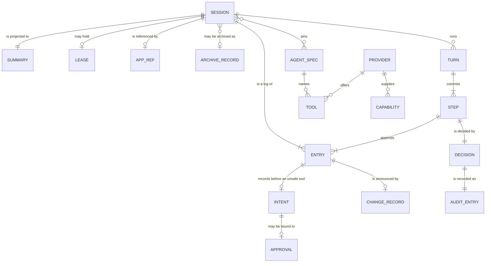
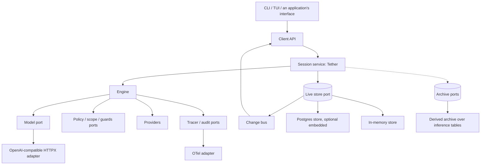

---
ddx:
  id: SD-001
  type: solution-design
  activity: design
  status: draft
  owner: Erik LaBianca
  updated: 2026-10-22
  authoring:
    home: repo
  links:
    - id: prd
      kind: informed_by
    - id: architecture
      kind: informed_by
    - id: ADR-001
      kind: informed_by
    - id: ADR-002
      kind: informed_by
    - id: ADR-003
      kind: informed_by
    - id: ADR-004
      kind: informed_by
    - id: ADR-005
      kind: informed_by
    - id: CONTRACT-001
      kind: informed_by
    - id: CONTRACT-002
      kind: informed_by
    - id: CONTRACT-003
      kind: informed_by
    - id: SPIKE-001
      kind: informed_by
    - id: SPIKE-002
      kind: informed_by
    - id: ADR-012
      kind: informed_by
    - id: ADR-013
      kind: informed_by
    - id: ADR-014
      kind: informed_by
    - id: ADR-015
      kind: informed_by
    - id: ADR-016
      kind: informed_by
    - id: ADR-017
      kind: informed_by
    - id: ADR-018
      kind: informed_by
    - id: ADR-019
      kind: informed_by
    - id: ADR-020
      kind: informed_by
    - id: concerns
      kind: informed_by
---

# SD-001: The Tether Library Design and Build Plan

**Feature**: all subsystems of the [PRD](../../01-frame/prd.md) (feature specifications `FEAT-001` to `FEAT-012` are written in `frame`). **Artifact**: `docs/helix/02-design/solution-designs/SD-001-tether-library-design-and-build-plan.md`

## Scope

- Feature-level design for the whole library: the engine, the session service, the live stores and archives, the client API, telemetry, the test kit, and the reference clients, and the order in which they are built.
- Not in scope: story-level designs (technical designs per slice, written when a slice starts), the first downstream platform's adoption work, and any server adapter.
- Governing artifacts: the PRD, the architecture, ADR-001 to ADR-020, CONTRACT-001 to CONTRACT-003, SPIKE-001, SPIKE-002, and `concerns.md`.

## Requirements Mapping

### Functional Requirements

| Requirement | Technical Capability | Component | Priority |
|------------|---------------------|-----------|----------|
| FR-1 to FR-5, FR-38 | The loop, the model port, the default OpenAI-compatible HTTPX adapter, and scripted/recording/replay doubles | Engine; `tether.adapters.openai_compat`; test kit | P0 |
| FR-6 to FR-10, FR-42 | `@tool`, the registry, argument validation, thread offload, approval bound to an invocation, typed results, the replay marker, intent before unsafe tools | Engine | P0 |
| FR-11 to FR-13, FR-16, FR-41 | Entry log, per-step commits, the lease with fencing, idempotent create and send, `InMemoryStore`, the Postgres live store, the embedded server | Session service; stores | P0 |
| FR-14, FR-34, FR-37 | Lease expiry, recovery, idempotent keys, the resume planner, opt-in automatic resume | Session service; engine | P0 (FR-37 P1) |
| FR-15 | Fork from an entry | Session service; stores | P2 |
| FR-17 to FR-21 | `Client`: list, get, entries, follow, commands; the change bus; benchmarks | Client; session service | P0 (FR-21 P1) |
| FR-22 to FR-25 | Tracer and audit ports, the OTel adapter, usage totals | Engine; `tether.adapters.otel` | P0 (OTel P1) |
| FR-26, FR-27 | Policy, scope, guards, providers (narrow only) | Engine; `tether.scope`, `tether.guards` | P1 |
| FR-28 | Dummies, conformance suites, cassettes, replay driver | Test kit | P0 |
| FR-29, FR-30, FR-33 | CLI, TUI, the zero-configuration demo | `tether.cli`, `tether.tui` | P0 |
| FR-31, FR-32, FR-36 | Packaging, extras, license files, contribution policy | Packaging | P0 |
| FR-39, FR-43 | The Databricks profile and its derived archive | `tether.adapters.databricks` | P1 |
| FR-40 | The archive ports and the derived-archive rules | Core ports; archives | P1 |
| FR-44 | `Tool.reconcile`, `Client.resolve` | Engine; client | P1 |
| FR-35 | Context compaction recorded in the log | Engine; session service | P1 |

### NFR Impact on Architecture

| NFR | Requirement | Architectural Impact | Design Decision |
|-----|------------|---------------------|-----------------|
| Concurrency | Many sessions, cancellation, no blocking | Async throughout; offload; structured task ownership by `Tether` | ADR-001 |
| Performance | Fast list, page, follow at scale | Summaries, keyset cursors, delta feed, bounded queues | ADR-004 |
| Reliability | No lost or duplicated committed step after a crash; no automatic rerun of an unsafe tool; an unknown outcome is explicit | Per-step atomic commit, lease with fencing, idempotent keys, intent before effect, the resume planner, declared store capabilities | ADR-005, ADR-010, ADR-014, ADR-019 |
| Provider independence | No foundation-model SDK; the Databricks gateway supported, never required | Owned adapter, banned SDK list, the Databricks profile | ADR-012, ADR-013 |
| Storage separation | Hot and cold needs met by different stores; a platform log usable as an archive | Live store and archive ports with capabilities | ADR-019, ADR-020 |
| Security | No content in telemetry; fail closed; engine invariants hold against a buggy extension | Content-free spans and audit, scrubbed adapter errors, gate order fixed by the engine, approval bound to an invocation, an explicit trust model | ADR-015, ADR-016, CONTRACT-002 sections 7 to 9 |
| Testability | Loop tested alone | Ports with dummies; cassettes; conformance suites | ADR-003 |

## Solution Approaches

### Approach 1: A single package with a concrete loop, store, and model client
**Description**: Build the loop against SQLite and one provider library directly, with no ports.
**Pros**: Fastest to a demo; fewest concepts.
**Cons**: No way to test the loop alone or to substitute storage or policy; the first downstream platform could not adopt it.
**Evaluation**: Rejected: the value is the boundary (ADR-003).

### Approach 2: Adopt an existing harness or framework as the engine
**Description**: Build on Pi Durable, LangGraph, or the OpenAI Agents SDK.
**Pros**: Less loop code.
**Cons**: Adopting a runtime changes the transition/state model and still needs Tether-specific policy, session and recovery integration. A single state owner is possible; duplication is an integration risk, not an inevitable defect. AgentKit supplies invocation supervision rather than the loop and does not replace the selected contracts (ADR-003).
**Evaluation**: Rejected.

### Approach 3: A ports-and-providers library with its own loop, built in staged slices (selected)
**Description**: Types and ports first, then the model port, the engine, the session log and service, the client API, then the adapters and clients; each slice is verifiable on its own.
**Pros**: Boundaries and dummies exist before features; each slice ships alone; the contracts are exercised from the start.
**Cons**: Tether maintains execution, persistence, recovery and protocol compatibility. The application keeps its own business state and a reference to the conversation; it must not create a second authoritative transcript.
**Evaluation**: Selected.

**Selected Approach**: Approach 3.

**Architecture/ADR impact**: ADR-001 to ADR-020 record the decisions; `architecture.md` records the module boundaries.

## Domain Model

### Business Rules
1. **One decision point**: every model call, tool call, retrieval, engagement, and widening is decided by the policy port and recorded, allowed or denied.
2. **Gates are the engine's**: a provider narrows (refuses, hides, redacts) and never widens; a failing hook closes.
3. **A step is one commit**: its entries, the summary update, and the change records are atomic before the next step starts, and durable on a store that declares durability.
4. **The log is the truth**: summaries and the feed are projections that cannot disagree with it.
5. **One turn per session**: a lease with a heartbeat enforces it; an expired lease is an interrupted turn.
6. **Content stays out of telemetry**: spans and audit entries carry identifiers, sizes, and reasons.
7. **The core reads no environment**: an application builds configuration and passes it in.
8. **Intent before effect**: an unsafe tool's intent is committed before it runs; an unknown outcome is explicit and never rerun automatically.
9. **An approval is bound**: to one invocation, its arguments, and its tool definition; it satisfies only the approval gate.
10. **One owner per kind of state**: the application holds a reference to a session and never a second transcript (ADR-018).
11. **Archiving is off the turn path**: a derived archive is read-only, partial, and reports pending, denied, or unavailable, never empty.

## System Decomposition

### Component: Types and ports
- **Purpose**: The payload types and the `Protocol` classes every other component builds on.
- **Responsibilities**: Frozen, validated models; the port definitions; no I/O.
- **Requirements Addressed**: FR-2, FR-6, FR-11, FR-17 to FR-20, FR-26
- **Interfaces**: CONTRACT-001 to CONTRACT-003.
- **Owned by TDs**: Slices 1 to 3.

### Component: Model adapters and doubles
- **Purpose**: Implementations of the model port.
- **Responsibilities**: The default OpenAI-compatible adapter over HTTPX with per-call identity, tags, request id and scrubbed errors; the Databricks gateway profile (slice 11); scripted/recording/replay doubles and cassettes. An optional Pydantic AI adapter is separate and subject to the dependency policy (ADR-002, ADR-012, ADR-013).
- **Requirements Addressed**: FR-2 to FR-5, FR-28
- **Interfaces**: CONTRACT-001.
- **Owned by TDs**: Slice 1.

### Component: Engine
- **Purpose**: Runs a turn.
- **Responsibilities**: Spec resolution, scope binding, model steps, the tool pipeline, gates, intent, approval, the resume planner, providers, cancellation, the commit at each step.
- **Requirements Addressed**: FR-1, FR-6 to FR-10, FR-22 to FR-27, FR-34, FR-42
- **Interfaces**: CONTRACT-002.
- **Owned by TDs**: Slices 2 and 7.

### Component: Session service
- **Purpose**: The session log's owner in the process, and the live change feed.
- **Responsibilities**: Turn tasks, the lease and recovery, summaries, the change bus, idempotent create and send, `Tether`, `InMemoryStore`, `InMemoryArchive`.
- **Requirements Addressed**: FR-11 to FR-14, FR-16, FR-19, FR-34, FR-41
- **Interfaces**: CONTRACT-003.
- **Owned by TDs**: Slices 3 and 9.

### Component: Live stores and archives
- **Purpose**: Persistence behind the two storage ports, each declaring its capabilities.
- **Responsibilities**: The Postgres live store with its migration runner, leases, and notifications; the embedded server; an optional SQLite store; the derived archive over gateway inference tables.
- **Requirements Addressed**: FR-16, FR-40, FR-43
- **Interfaces**: CONTRACT-003 sections 3 and 4.
- **Owned by TDs**: Slices 5 and 11.

### Component: Client API
- **Purpose**: The UI boundary.
- **Responsibilities**: List, get, entries, follow, commands; the benchmark suite.
- **Requirements Addressed**: FR-17 to FR-21
- **Interfaces**: CONTRACT-003 section 5.
- **Owned by TDs**: Slice 4.

### Component: Telemetry
- **Purpose**: Spans, audit entries, and usage.
- **Responsibilities**: The tracer and audit ports, the OTel adapter, the content test.
- **Requirements Addressed**: FR-22 to FR-25
- **Interfaces**: CONTRACT-002 section 6.
- **Owned by TDs**: Slice 6.

### Component: Test kit
- **Purpose**: A dummy for every port, the conformance suites, cassettes, the replay driver, and benchmarks.
- **Requirements Addressed**: FR-28
- **Owned by TDs**: Slices 1 to 6.

### Component: Reference clients
- **Purpose**: A command-line client and a terminal UI for development and testing.
- **Requirements Addressed**: FR-29, FR-30
- **Owned by TDs**: Slice 8.

### Component Interactions

## Technology Rationale

| Layer | Choice | Why | Alternatives Rejected |
|-------|--------|-----|----------------------|
| Language | Python 3.11 and later | Direct embedding of Python tools and application objects; browser transport stays in the existing application (ADR-003) | TypeScript harness or dual runtimes; accept the cross-language browser contract |
| Models and ports | `pydantic` v2 frozen models, `typing.Protocol` | Validation and JSON Schema for tools; structural typing for ports that tests implement | Dataclasses (no validation); abstract base classes |
| Concurrency | `asyncio` with `anyio` for offload and cancellation scopes | ADR-001 | Threads per turn; a sync and an async twin |
| Model client | Owned OpenAI-compatible HTTPX adapter behind `ModelPort` | ADR-002, ADR-012, SPIKE-002 | Provider SDKs and framework-owned default clients; optional adapters require compliant dependency closure |
| Stores | In-memory first, then Postgres through `psycopg` with an optional embedded PostgreSQL 18; SQLite optional | Ports tested code from the first consumer; real cross-process leases and notifications (ADR-020) | SQLite as the only durable store; a server database with no embedded option |
| Packaging | One distribution with extras, `uv`, `hatchling` with `uv-dynamic-versioning` | The `python-uv` concern; one install for users | Several distributions (premature) |
| Boundary gate | `scripts/check_layers.py` and a clean-environment run | A repository script and an undeclared-import test | A third-party import checker |

### Application integration boundary

Retain the existing Databricks Apps server and its UI transport. The library exposes `Client` to that process; it does not add an AgentKit server, another supervisor, or a second TypeScript implementation. No AgentKit integration or comparative-wrapper experiment is a release dependency. Revisit adoption only through the concrete replacement/deletion criterion in ADR-003.

## Staged Build Plan

Each slice is one change that leaves the repository releasable. The first downstream platform's loop is the reference for behavior: its characterization scenarios (listed below) are ported as tests in slice 2 so parity is checked mechanically. Code and tests are ported from that platform only after they are read and scrubbed (AGENTS.md).

| Slice | Does | Verifiable outcome |
|-------|------|--------------------|
| 0. Scaffold | `pyproject.toml` (`uv`, `hatchling`, `uv-dynamic-versioning`), `src/tether/` skeleton with `py.typed`, `ruff`, `pyright`, `pytest` with the `anyio` plugin and `hypothesis`, ceilings, `scripts/check_layers.py`, CI, a pre-commit hook, license metadata | The gates pass on the skeleton; the layering check rejects each planted forbidden import (negative controls); a clean install shows both license texts |
| 1. Types, model port, doubles, adapter | `tether.types` and `tether.ports` for the model port; scripted, recording, and replay doubles and the cassette; `model_port_suite`; the default HTTPX adapter with wire tests and local-server conformance | The suite passes for every double and the adapter, including concurrent calls that keep their own identity and cancellation that propagates; a cassette round-trips; one live smoke call succeeds against a real provider on a fabricated prompt (the owner supplies a credential at run time, never in the repository) |
| 2. Engine core | `@tool`, the registry, the pipeline, required authorization/approval/intent gates, configured guards, providers, in-process interaction dummies, against a stub `TurnLog` | The ported characterization scenarios pass; narrow-only property tests pass; the `ASYNC` lint rules are clean; a plain-function tool does not block a concurrent task |
| 3. Sessions | Entries, `InMemoryStore`, `Tether`, the lease, recovery, summary projection, the change bus; `live_store_suite` | The suite passes; a simulated death between steps leaves each completed step once; the summary equals the rebuilt projection |
| 4. Client API and benchmarks | `Client`: list, get, entries, follow, commands; the benchmark suite | FR-17 to FR-20 acceptance sketches pass; the benchmark baseline is committed; the owner sets budgets from it |
| 5. Postgres live store | `tether.stores.postgres` ported from the first consumer's backend, its migration runner, the embedded server extra, the live store suite, benchmarks | The suite passes on PostgreSQL 18, including a cross-process lease and fencing test; the embedded server's start time is measured against the quickstart budget; benchmarks compared with the in-memory baseline |
| 6. Telemetry | The tracer and audit sinks, usage totals, the OTel adapter | The content test finds the marker in no span or audit entry; spans nest across awaits and tasks |
| 7. Governance | Policy, scope binder and kinds, spec resolver, result guards, provider conformance, the optional `tether.scope` and `tether.guards` | The suites pass; a provider cannot widen a decision (property tests); a failing hook closes |
| 8. Reference clients | `tether.cli` and `tether.tui`, the demo model | Scripted end-to-end sessions pass for the CLI; the TUI shows a list, a live transcript, and an approval in a pseudo-terminal test; the quickstart is timed |
| 9. Durability | Intent entries and invocation ids, the approval lifecycle, the resume planner, the `replay` marker, idempotent step keys | A real process killed between steps resumes or reports interrupted, each committed entry once and no automatic rerun of an unsafe invocation; V-H1/V-H2/V-H3 and the failure-point matrix qualify the boundary beyond log prefixes |
| 10. Release 0.1 | Documentation, the quickstart test, packaging, publication | A clean environment passes the quickstart; both license texts ship; the first downstream platform's parity check is run |
| 11. Databricks profile and archive | `tether.adapters.databricks` (ported gateway client settings, identity modes, tier map), the archive ports' conformance suite, the derived archive over inference tables | The profile passes the model port suite against recorded gateway responses; the derived archive reports pending, denied, and unavailable correctly; call content is read as the calling actor |
| 12. Reconcile and resolve | `Tool.reconcile`, `Client.resolve` | An unknown outcome resolved by reconcile or by a caller leaves a log the planner treats as finished |

**Characterization scenarios (slice 2)**: a plain answer; an allowed tool call; a call denied as not permitted; a call denied as scope required; invalid arguments; a tool that raises; the step limit; a model outage mid-stream; a model call denied; manual approval approved, declined, and superseded by a new message; a tool that always asks; a result flagged by the scan; a result outside the bound context; a widening that rolls back; a tool hidden by a stage; a hook that raises; a cancelled turn.

### Framework review verification

The [framework review](../../00-discover/agent-harness-framework-review.md#current-disposition-after-coordinated-design-reconciliation) selects no additional runtime dependency. The following cases make its recommendations concrete for the existing slices. They are planned acceptance work, not executed evidence. All inputs, identities, documents, and effects are fabricated.

| Case | Requirement / finding | Primary owner and slice | Proposed acceptance evidence |
|---|---|---|---|
| V-H1. Unsafe effect completes before result commit | FR-14/34/42; H1 | Engine and durable store, slice 9 | A separate process records an observable fabricated effect, then is killed before result append. Intent survives, outcome is unknown, resume never automatically reruns that invocation, and committed entries/summary/feed agree |
| V-H1b. Fresh model call repeats an unresolved effect | FR-42/44; H1 | Engine/policy design before slice 9; reconcile in slice 12 | Model emits an equivalent unsafe action with a new call ID after timeout/error/unknown. Demonstrate the chosen application/core refusal or renewed-authorization boundary; a new ID must not be treated as proof the earlier effect did not happen |
| V-H2. Synchronous tool outlives cancellation | FR-6/20/42; H2 | Engine/offload and durable store, slices 2/5/9 | Block a real worker-thread tool on a controlled barrier, cancel or expire its lease, start a contender, then release the old tool. Show stale writes are rejected and external-effect uncertainty is preserved; measure outstanding worker capacity rather than counting only waiting coroutines |
| V-H3. Approval races and compatibility | FR-8/20/42; H3 | Engine/client, slices 2/4/9 | Duplicate answers have one winner; changed actor rights, arguments or tool digests refuse execution; restart between approval and intent preserves valid approval without skipping authorization |
| V-M1. Bounds and absent usage | FR-1/5/25/26; M1 | Model adapter, engine/policy, slices 1/2/7 | Configured tool/hook deadlines and step limits work; configured policy handles missing usage explicitly. Oversized request/tool output and retry exhaustion follow an explicitly selected adapter/application policy; no inferred zero usage or stacked retries |
| V-M2. Small context and long history | FR-35/38; M2 | Application context provider; P1 context work | Configure a small-context local-server profile; retain authoritative history while bounding model input. Pending tool pairs, approvals and unknown outcomes survive any selected redaction/compaction. Do not claim default long-session support before a bound/overflow policy is selected |
| V-M3. Failure-point matrix | FR-14/28/34/42; M3 | Engine and store test kit, slice 9 | Inject failure before intent, after intent/before dispatch, after external effect, during result normalization, before/after commit, and before notification. Cover ordered mixed safe/unsafe batches; log-prefix property tests supplement these execution tests |
| V-M3b. Replay and stochastic task quality | FR-28/38; M3 | Test kit, slices 1/2 and application qualification | Fixed-response replay reproduces runtime decisions and reports request drift. Separately grade fabricated research, extraction and approved-action outcomes across named server/model profiles; report repeated-trial results without treating replay as model-quality evidence |
| V-M4. Dependency boundaries | FR-31/38; NFR-8; M4 | Packaging and adapter owners, slices 0/1 | A clean default install has no banned SDK imports or transitive dependencies. A later optional adapter must qualify its own exact dependency closure before support is claimed; no Pydantic AI installation is required for 0.1 |
| V-CLIENT. Identity and reconnect | FR-4/17–20; NFR-4/6 | Client/store and telemetry, slices 4/5/6 | Two concurrent actors retain separate credentials, reconnect from persisted positions, and recover authoritative changes while slow readers stay bounded; no prompt, tool-content or credential marker appears in operational telemetry |

**Remaining design details.** Before slice 9 acceptance, resolve H1's fresh-call retry boundary and H2's outstanding-worker/replacement-work behavior in CONTRACT-002 and the relevant ADRs. Current intent records and fenced appends do not settle either question. The integration application must supply target-system idempotency, reconciliation, or fencing where effects require it; Tether cannot infer semantic equivalence of arbitrary tool arguments. Owner: Erik LaBianca with the engine/policy author. P1 reconciliation does not silently become a P0 dependency, and a P0 unknown must not be advertised as an automatically recoverable effect.

**Sequencing.** Approval enforcement, current authorization and pre-effect intent are required whenever an unsafe tool is dispatched, including characterization/demo paths. Later slices add production storage and fault qualification; they do not authorize an earlier path to bypass those gates. Compaction remains P1 under FR-35; configurable usage/cost thresholds remain application policy. The numeric performance targets remain proposals until measured.

**Evidence closeout.** A qualification run should record the source/artifact versions, selected store capabilities, configured deadlines/context policy, fabricated scenario IDs, model/server profile when applicable, fault point, observed effects and recovery state, verification result, and capture limits. OTel claims additionally need a real receiver/export correlation check under the selected diagnostics practice; console silence and no-op tracers prove no exporter integration. Store operational evidence separately from content-bearing fabricated eval fixtures. No framework benchmark or provider SDK installation is a release gate.

## Traceability

| Requirement ID | Component | Design Element | Test Strategy |
|---------------|-----------|----------------|---------------|
| FR-1 to FR-5 | Engine, model adapters | CONTRACT-001, CONTRACT-002 sections 1 and 8 | Characterization scenarios; `model_port_suite` |
| FR-6 to FR-10 | Engine | CONTRACT-002 section 4 | Tool and approval scenarios; offload test |
| FR-11 to FR-16, FR-41 | Session service, stores | CONTRACT-003 sections 1 to 3 | `live_store_suite`; kill tests |
| FR-14, FR-34, FR-37, FR-42 | Engine, session service | CONTRACT-002 sections 8 to 10; ADR-010, ADR-014, ADR-015 | Prefix property test; real-process kill tests |
| FR-39, FR-40, FR-43, FR-44 | Databricks profile, archives | CONTRACT-003 section 4; ADR-013, ADR-019 | Archive suite; recorded gateway responses |
| FR-17 to FR-21 | Client API | CONTRACT-003 sections 5 to 7 | Acceptance sketches; benchmarks |
| FR-22 to FR-25 | Telemetry | CONTRACT-002 section 6 | Content test; span nesting tests |
| FR-26, FR-27 | Engine | CONTRACT-002 sections 2, 4, 5 | Governance suites; property tests |
| FR-28 | Test kit | CONTRACT-001 section 2; CONTRACT-002 section 12; CONTRACT-003 section 8 | Each suite passes for its dummy |
| FR-29, FR-30 | Reference clients | Slice 8 | End-to-end and pseudo-terminal tests |
| FR-31, FR-32, FR-36 | Packaging | ADR-006, ADR-007, slice 0 | Clean-environment install test |

### Gaps
- [ ] Feature specifications and user stories are not yet written; `frame` writes them and maps each FR to a story.
- [ ] The performance numbers are proposals (NFR-7); the first baseline validates or replaces them.
- [ ] Content by reference in the live store, backed by a derived archive, is undecided (ADR-019).
- [ ] H1/H2: specify fresh-call handling of unresolved unsafe effects and outstanding synchronous-worker/replacement-work behavior before slice 9 acceptance; execute the failure-boundary cases above.

## Concern Alignment

- **Concerns used**: `python-uv`, `hexagonal-architecture`, `modularity-and-encapsulation`, `concurrency-model`, `testing`, `o11y-otel`, `resilience`, `security-owasp`, `scope-discipline`, `code-shape-ceilings`.
- **Constraints honored**: the core reads no environment; every port has a dummy and a suite; gates fail closed; telemetry carries no content; ceilings apply globally with no per-file exceptions.
- **ADRs referenced**: ADR-001 to ADR-020.
- **Departures**: the core does not use `pydantic-settings` (ADR-003; recorded in `concerns.md`).

## Constraints & Assumptions

- **Constraints**: Python 3.11 and later; asynchronous only; no dependency beyond the core's `pydantic` and `anyio` without an ADR; no credential, private data, or reference to a private repository in the repository, fixtures, or cassettes.
- **Assumptions**: A hosted CI service is available; the first downstream platform will adopt a library release. The existing Apps deployment is context, not proof that every proposed library contract is implemented.
- **Dependencies**: `pydantic` and `anyio` in the core; `httpx` for the default model adapter; Textual and OpenTelemetry in their selected extras. Pydantic AI is an optional, separately audited adapter. AgentKit and foundation-model provider SDKs are excluded under ADR-003 and ADR-012.

## Risks

| Risk | Prob | Impact | Mitigation |
|------|------|--------|------------|
| The ports or the provider surface are too narrow or too wide | M | H | Port the first downstream platform's scenarios in slice 2; amend the contracts before slice 10 |
| Per-step commits cost too much latency | M | M | One commit per step with its entries batched; benchmarks in slices 4 and 5 before the budgets are set |
| The embedded Postgres starts too slowly for the quickstart | M | M | Measure in slice 5; the demo falls back to in-memory, or a SQLite store is built (ADR-020) |
| A derived archive is mistaken for a complete record | M | H | Capability flags and the pending, denied, unavailable results; the suite checks them (ADR-019) |
| The change feed's resume and coalescing rules are subtle | M | H | Property tests for ordering and resume; consider a bounded model (formal-methods) if tests find surprises |
| A blocking call stalls the event loop | M | H | Offload; `ASYNC` lint rules; a loop-lag test |
| Protocol variations or optional-adapter dependencies break compatibility | M | M | HTTPX wire tests and local-server conformance; exact pins and dependency-closure checks for any optional adapter |
| Unverified competitor cells hide a product that already does this | M | H | Validate in `frame` before building past slice 4 |
| Publication blocked by a repository or release decision | L | M | Slices 0 to 9 proceed privately |

## Open Decisions

| Decision | Owner | Blocks |
|----------|-------|--------|
| The performance numbers (proposals in NFR-7) | Erik LaBianca | Slice 4 acceptance, slice 10 |
| Postgres embedded or SQLite for the durable demo | Erik LaBianca | Slice 5 |
| Whether the live store may hold call content by reference to a derived archive | Erik LaBianca | Slice 11 |
| Fresh-call handling of an unresolved unsafe effect, and replacement work while a synchronous tool is still running (H1/H2) | Erik LaBianca with the engine/policy author | Slice 9 acceptance; slice 10 |
