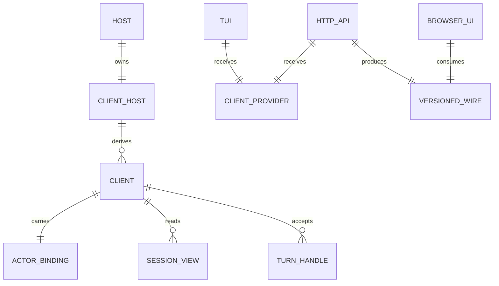
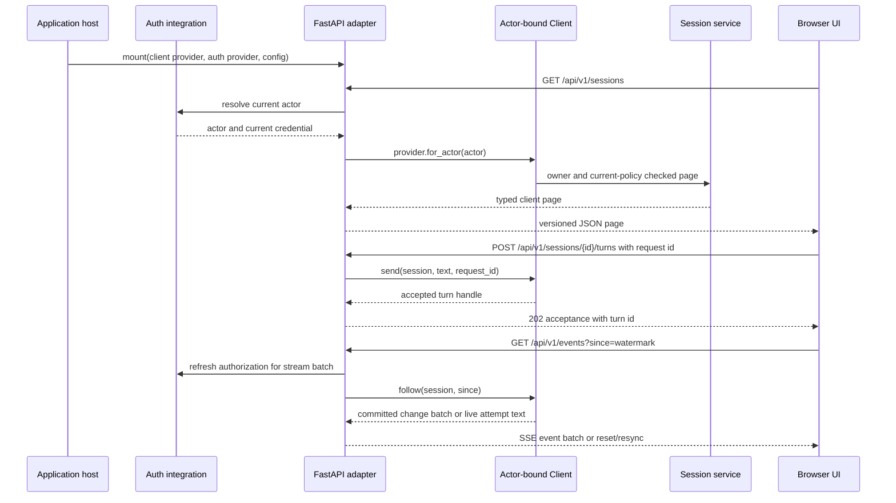

---
ddx:
  id: SD-002
  type: solution-design
  activity: design
  status: draft
  owner: Erik LaBianca
  updated: 2026-10-29
  authoring:
    home: repo
  links:
    - id: prd
      kind: informed_by
    - id: architecture
      kind: informed_by
    - id: FEAT-013
      kind: informed_by
    - id: FEAT-014
      kind: informed_by
    - id: FEAT-015
      kind: informed_by
    - id: FEAT-016
      kind: informed_by
    - id: FEAT-017
      kind: informed_by
    - id: ADR-004
      kind: informed_by
    - id: ADR-022
      kind: informed_by
    - id: CONTRACT-003
      kind: informed_by
    - id: CONTRACT-006
      kind: informs
---

# SD-002: Embeddable Client and Web Interfaces

**Features**: HTTP API and Remote Clients (FEAT-014), Composable React Interfaces (FEAT-015), dependent on FEAT-013/016/017; FR-65–70, NFR-9. **Artifact**: `docs/helix/02-design/solution-designs/SD-002-embeddable-client-and-web-interfaces.md`

## Scope

- Extend the `tether.client` consumer boundary with a stable protocol, explicit host composition settings and lifecycle, then provide independently replaceable TUI, HTTP API, and browser UI consumers.
- The application owns runtime composition, identity, server lifecycle, deployment, storage selection, policy, and credentials. The client owns Tether behavior and authorization. The API translates HTTP into the client protocol; the browser speaks only its versioned wire contract.
- Governing artifacts: PRD FR-65/NFR-9 and subsystem requirements; Architecture's Encapsulated Interface Components; ADR-004; CONTRACT-003 and CONTRACT-005. CONTRACT-006 defines the exact proposed client, wire, and package surfaces.
- FEAT-014 and FEAT-015 govern HTTP and React behavior. FEAT-013 supplies their client boundary; FEAT-016 and FEAT-017 own the optional Databricks adapter and package qualification. Product scope comes from PRD FR-65–70.

## Requirements mapping

| Requirement | Technical capability | Component | Priority |
|---|---|---|---|
| FR-65 | Adopt, extend, or replace API and browser UI independently; authorized terminal and browser clients share owner-scoped sessions and preserve client semantics | `tether.client`, `tether.tui`, `tether_web_api`, `tether_web_ui` | P2 |
| FR-66 | Public host construction, settings/lifecycle, advanced ports, and injected embedded/remote TUI parity | FEAT-013; `tether.client`, `tether.tui` | P2 |
| FR-67 | Typed versioned HTTP surface covers every Client method and preserves commit-aware reconnect/feed semantics | FEAT-014; `tether_web_api` | P2 |
| FR-68 | Framework-free TypeScript transport client, React hooks, composable UI, reference application and supported presentation slots | FEAT-015; browser packages and reference app | P2 |
| FR-69 | Independently selected Databricks application adapter and history profile with qualified ownership boundaries | FEAT-016; `tether_databricks` and API integration | P2 |
| FR-70 | Reproducible optional packages, compatibility checks, release artifacts and an independent embedder repository proof | FEAT-017; Python/web packaging and release checks | P2 |
| NFR-9 | Inject typed clients, authentication, and presentation without private imports or mandatory web dependencies | All interface factories; dependency and substitution gates | Required before accepting optional web components |
| FR-17–20, FR-48 | Keep summary lists, reads, reconnect, commands, approval, and disclosure semantics consistent across local and HTTP clients | `tether.client`, API mapper, browser client | Existing P0 behavior is inherited |
| FR-29–30, FR-33 | Run the reference TUI over an injected public client and keep its demo composition at the launcher boundary | `tether.tui`, `tether.cli` | Existing reference-client scope |

### NFR impact

| NFR | Architectural impact | Design decision |
|---|---|---|
| NFR-9 | Consumers must work with a substitute typed client; the core install must not import UI or server frameworks | `ClientProtocol` and explicit factories live in `tether.client`; optional web distributions own framework imports |
| NFR-6 | Remote subscribers and feed adapters must remain bounded and nonblocking | Reuse client feed semantics, bound each stream, expose lag and resync, and disconnect slow consumers |
| NFR-9 | Extensions must have stable runtime and presentation seams | Publish only typed provider/auth, layout, and message-rendering slots; do not require subclasses or private imports |
| Security and disclosure (CONTRACT-002/003/005) | Browser requests and long-lived streams can outlive identity or policy changes | Resolve a current actor-bound client per request and recheck current policy for every page, event batch, and content disclosure |
| Compatibility | Python and TypeScript callers need stable semantic values across transports | Keep core values transport-neutral; version HTTP wire schemas and generate browser types from OpenAPI/event schemas |

## Solution approaches

### Keep concrete in-process clients and make each interface construct its own runtime

Rejected. It duplicates stores and policy composition, makes TUI replacement difficult, and causes terminal and browser views to diverge even when they should share a host and owner namespace.

### Publish one typed client boundary and inject it into independent consumers

Selected. The proposed public `ClientHost` is the ordinary composition and resource-lifetime owner. It returns actor-bound clients conforming to a public protocol. TUI, HTTP routes, and browser hosting receive clients or typed providers. Existing `Tether(...)` composition remains a compatibility path. A remote browser uses an HTTP implementation of the client semantics; it does not import Python framework or runtime types.

### Put HTTP and browser code in the base distribution

Rejected. Every embedder would inherit framework dependencies and deployment assumptions despite FR-65 making interfaces optional and independently replaceable.

**Architecture/ADR impact**: ADR-004 establishes the client boundary and optional adapter direction. Architecture defines the module map and application ownership. ADR-022 records package and framework decisions and governs technology details. CONTRACT-006 owns exact interfaces and HTTP behavior.

## Domain model

### Business rules

1. A client is actor-bound, and each operation uses the current credential and policy required by CONTRACT-003/005. An actor or history reference is not a bearer grant.
2. A caller that supplies a host owns it and closes it. A borrowed interface client does not close the host. Standalone launchers explicitly own both composition and shutdown.
3. Accepted turns outlive an HTTP request or browser disconnect. Cancel is an explicit client command. A remote operation handle identifies accepted work; final result retrieval stays bounded and owner-authorized.
4. A browser and TUI share state only when they use the same service and owner namespace. Separate processes require a qualified shared-store profile.
5. An unavailable history page remains an explicit `pending`, `denied`, `unavailable`, or other declared status. It never becomes an empty successful page or cached content from a broader identity.

## System decomposition

| Component | Responsibilities and interfaces | Dependencies and restrictions |
|---|---|---|
| `tether.client` | Owns `ClientProtocol`, exported transport-neutral types/errors, host settings and lifecycle, actor-bound facade, and published integration seams | May adapt internal session services; no TUI, web, or framework imports |
| `tether.tui` / `tether.cli` | Own presentation and launch composition; accept injected clients; launcher may explicitly build a local host | `tether.client`, presentation code, optional Textual; no engine, sessions, stores, or web imports |
| `tether_web_api` | FastAPI factories, authentication-to-client provider adaptation, versioned HTTP schemas, OpenAPI and event schema, bounded stream translation | `tether.client`, FastAPI optional extra; no engine/storage internals, TUI, or browser UI imports |
| `tether_web_ui` | Mountable UI and built browser assets; hosting path/root configuration and presentation replacements | Own assets and optional host integration; no runtime internals or API implementation imports |
| `@tether/client` | Framework-free TypeScript transport client and generated wire types | Fetch/Web APIs and generated contract only; no React |
| `@tether/react` | Hooks and React provider around injected `@tether/client` instance | React peer dependency; no hidden client construction |
| `@tether/ui` | Typed composable UI and explicit slots for layout/message rendering | React components and public client hooks; no API server or Python imports |

The embedder constructs `ClientHost` once with explicit model, policy, specs, limits, and a public storage profile. `LocalJsonlSettings(root)` asks the host to acquire its JSONL store and history resources; `ProvidedStorage(store, history)` supplies borrowed public ports. The host derives message-history access from the selected history provider. The embedder supplies its authentication integration and passes a borrowed client/provider into each interface factory. FastAPI request and response objects stay inside `tether_web_api`. Core errors and data types stay transport-neutral; HTTP error bodies and schemas are owned by the API package. The UI package may be hosted beneath a configurable root path and must resolve its asset URLs under a reverse-proxy prefix.

The public profile names and exact settings fields are proposed contract choices. They follow the resource-opening sequence already exercised by the demo but require focused constructor, ownership, and failed-open cleanup tests before support is claimed.

### Component interactions

The sequence is a proposed contract trace. It does not claim a shipped FastAPI package, browser runtime, or deployment qualification. A stream must refresh identity and authorization at each bounded read/delivery boundary; revocation closes it without disclosing later events.

## Technology rationale

| Layer | Choice | Rationale | Alternatives rejected |
|---|---|---|---|
| Python interface | Typed `Protocol` plus injected provider; optional remote implementation under `tether.client` | Preserves substitutability; remote transport dependencies stay out of the base install | Concrete app/runtime coupling |
| HTTP server | FastAPI in optional API extra | Produces typed HTTP routes and OpenAPI while keeping the core import closure small | Server in core; application-specific routes only |
| Browser workspace | npm workspaces, package-lock, strict TypeScript with `noUncheckedIndexedAccess`, Vite, ESLint, Vitest, Testing Library, and MSW | Reproducible local package graph and typed browser development; exact versions are locked | Global installs and undeclared network mocks |
| Browser client | Framework-free `@tether/client` with runtime schema validation | Shares OpenAPI schemas without forcing React on consumers; validates events at the network boundary | React embedded in the transport client |
| UI composition | React 19, client-mode React Router, TanStack Query and `@tether/react`/`@tether/ui` | Separates transport, state coordination, hooks and components; one reducer owns stream/list state | Monolithic Python template or independent event-reduction rules |
| Styles | Tailwind 4 tokens and composable semantic elements | Embedders may opt into styles and replace layout/message rendering while preserving accessible behavior | Mandatory third-party component framework |
| Wire contract | Versioned OpenAPI plus discriminated event schema | Supports generated types and explicit compatibility checks | Reusing Python model serialization as an undocumented wire format |

ADR-022 records selected framework and package-manager choices, dependency versions, and release packaging. The proposed initial JavaScript budget is 250 KiB gzip; the implementation plan must attach a measured build report before treating that value as an acceptance threshold. No support claim follows from this proposal alone.

## Traceability

| Requirement | Component | Design element | Proof strategy |
|---|---|---|---|
| FR-65–66 | Client, API, UI, TUI | Independent factories, shared host, public settings/lifecycle and remote/embedded injection | Conforming dummy substitution, same-host TUI/browser scenario, API/UI replacement examples |
| FR-67 | API | Every client method has an HTTP route or explicit capability result; generated schemas retain 64-bit values without JavaScript rounding | OpenAPI conformance, route parity inventory, sequence/position/usage values above 2^53, reconnect and unknown-outcome cases |
| FR-68 | TS packages and reference app | Separate transport, hooks, components, app, and replaceable layout/message renderers | Package substitution, accessibility and malicious-markup cases, reproducible build and measured bundle |
| FR-69 | Databricks adapter | Optional package and authorized source integration | Profile-specific test evidence and missing/partial/unavailable history checks |
| FR-70 | Package/release | Isolated optional dependency closures, generated asset inclusion, compatibility and external consumer proof | Clean install, locked package build, artifact inspection, cross-repository embedder install |
| NFR-9 | Client and all consumers | Import/dependency boundaries, client and provider injection, public extension ports | Layer checker with negative controls, clean core install, type checking against protocol-only dummy |
| FR-17–20/48 | API and browser client | Pages, atomic snapshot, commit-aware feed, reconnect, explicit commands | Contract tests for paging, `last_in_commit`, retention gaps, lag, cancellation, approval races |
| FR-29/30/33 | TUI and CLI | Injected client; owned local launcher | Run TUI against a dummy; verify launcher closes owned host and injected host stays borrowed |
| History disclosure | API and browser client | Current policy check per read, separate call-payload permission, explicit history status | Revocation, denial, provider outage, partial and oversized page cases |

### Gaps

- [ ] FastAPI framework versions and compatibility ranges require installed-package qualification under ADR-022.
- [ ] The Databricks adapter and reproducible release/independent-embedder proof are specified in FEAT-016/017 and sequenced by IP-002.
- [ ] The current TUI constructs the local demo internally. Its injected-client factory and lifecycle split are proposed work.
- [ ] Existing Client methods have no general capability descriptor. CONTRACT-006 proposes capability negotiation; implementations must not infer support from absent optional payloads.
- [ ] Remote result recovery needs a bounded spike and journal-backed implementation proof. FR-67 cannot be accepted until a replaced API process can recover the terminal outcome or explicit pending state without duplicate dispatch.

## Concern alignment

- **Concerns used**: async Python, dependency isolation, hexagonal boundaries, testing, and optional reference-client integrations.
- **Constraints honored**: no environment discovery in core; no mandatory interface dependencies; application owns auth and deployment; framework types do not enter public core types.
- **ADRs referenced**: ADR-001 for async behavior, ADR-004 for the UI boundary, ADR-011 for explicit credentials, ADR-016 for trusted in-process extensions, and ADR-022 for selected web/platform decisions.
- **Departures**: none proposed.

## Constraints, dependencies, and risks

- Ordinary embedder construction uses the public settings/factory and exported ports defined by FEAT-013 and CONTRACT-003. An advanced composition path may supply custom engine and store integrations through explicitly exported ports. The host binds to its owning event loop and closes only resources it owns.
- `tether_web_api`, `tether_web_ui`, and `tether_databricks` and their optional dependencies are separate from the core install. Browser bundles are built assets owned by the UI package; the published Python UI package must include them reproducibly.
- OpenAPI is the source for HTTP request/response types. Stream event discriminators are generated or validated from the same wire source. Runtime validators must protect browser parsing. Sequence, position, token usage and other 64-bit integers must retain exact values in JavaScript, using decimal strings on the wire where numeric JSON would round. Additive optional fields are compatible within a wire major version; removing or changing meaning requires a new major path.
- Risks include stale identity on a long-lived stream, a disconnected request masking an accepted command, package asset path errors behind proxies, API and Python method drift, and accidental message markup execution. Contract errors, idempotency keys, per-batch auth, root-path tests, generated schema diff checks, and plain-text-by-default message rendering address these risks.

## Diagnostic flow

Interface request observations may record route template, command outcome, durations, byte counts, actor/session identifiers, and rejection reason through the existing metadata-only telemetry boundary. They must not record message text, tool arguments, model exchanges, cookies, authorization headers, or credentials. HTTP request IDs remain transport-local unless explicitly correlated to a client `request_id`; they do not create trace authority.

## Architecture walkthrough

The critical scenario is an HTTP send followed by browser reconnect. The API resolves a current actor, obtains an actor-bound client, and calls `send` with a stable request ID. A lost response is retried with that same ID; the client returns the accepted handle or explicit conflict. The browser snapshots session state, reads entries through the captured head, then follows after its per-owner watermark. It advances the watermark only after `last_in_commit=true`. Live reply text is keyed by turn and attempt offsets; reconnect, lag, or reset discards provisional text and relies on committed history. The browser never treats provisional text as approval or final output.

Verification must cover accepted response loss and retry, stale or revoked stream identity, event batches split across commits, retention gaps, unavailable history, current raw-payload authorization, and browser rendering of untrusted message content. Contract checks do not qualify a particular production server, proxy, identity backend, or storage profile.
