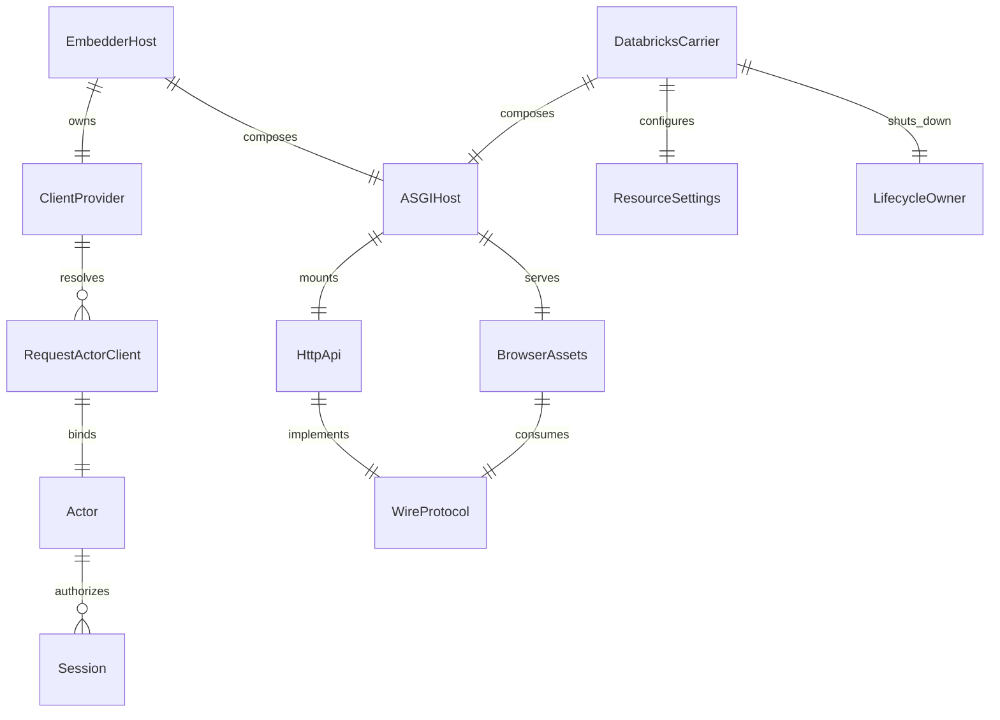
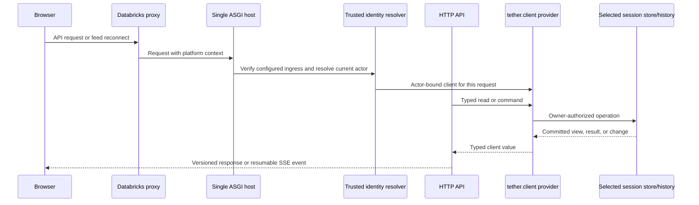

---
ddx:
  id: SD-003
  authoring:
    home: repo
  links:
    - id: prd
      kind: informed_by
    - id: FEAT-016
      kind: informed_by
    - id: architecture
      kind: informed_by
    - id: ADR-004
      kind: informed_by
    - id: ADR-011
      kind: informed_by
    - id: ADR-013
      kind: informed_by
    - id: ADR-020
      kind: informed_by
    - id: ADR-022
      kind: informed_by
    - id: CONTRACT-003
      kind: informed_by
    - id: CONTRACT-005
      kind: informed_by
    - id: CONTRACT-006
      kind: informed_by
    - id: CONTRACT-007
      kind: informs
    - id: TP-002
      kind: informs
    - id: IP-002
      kind: informs
---

# SD-003: Web Interfaces and Databricks Apps Carrier

**Feature**: FR-65 through FR-70, optional web reference clients and a Databricks Apps example carrier. **Artifact**: `docs/helix/02-design/solution-designs/SD-003-web-and-databricks-apps-carrier.md`

## Scope

This design adds optional, independently installable HTTP API and browser UI packages and a reusable Databricks Apps carrier example. `tether.client` remains the sole Tether behavior boundary. One FastAPI ASGI host mounts the HTTP API and serves the built browser assets. The consumer owns identity, policy, storage roles, deployment, and business data.

The packages are separate distributions with top-level import namespaces `tether_web_api`, `tether_web_ui`, and `tether_databricks`. ADR-022 proposes the distribution names `novirhiza-tether-web-api`, `novirhiza-tether-web-ui`, and `novirhiza-tether-databricks`; registry availability remains a release check. The browser code is TypeScript compiled to JavaScript. The Databricks example lives under `examples/databricks-app`; it contains a complete app and bundle composition using public factories. The real embedding application remains a separate consumer and supplies its own configuration and data.

Governing requirements are FR-65 through FR-70 and NFR-9. Architecture and ADR-004 own the client boundary; CONTRACT-003 owns client semantics, CONTRACT-006 owns the HTTP/browser surface, and CONTRACT-007 owns the Databricks carrier composition. No web or Databricks dependency enters the base install.

## Requirements Mapping

| Requirement | Technical capability | Component | Priority |
|---|---|---|---|
| FR-65 / NFR-9 | Replaceable API and UI over the public typed client, with shared sessions and preserved authorization, approval, recovery, and disclosure behavior | Web distributions | P2 |
| FR-66 | One client facade for local and remote use, including TUI parity | `tether.client`, remote client adapter, TUI | P2 |
| FR-67 | Typed versioned HTTP mappings for client reads and commands; snapshot plus resumable change feed | `tether_web_api` | P2 |
| FR-68 | Independent TypeScript API client, React hooks and UI; documented replacement seams | `tether_web_ui` | P2 |
| FR-69 | Typed Databricks identity, settings, resource and lifecycle helpers; complete runnable carrier example | `tether_databricks`, `examples/databricks-app` | P2 |
| FR-70 | Reproducible package, dependency, compatibility, release and external embedder evidence | package/release workflow | P2 |

### NFR Impact on Architecture

| NFR | Architectural impact | Design decision |
|---|---|---|
| NFR-1 / NFR-2 | I/O stays async; core does not read environment | Web factories accept explicit settings and providers. The example composition root maps environment values into settings. |
| NFR-4 / ADR-011 | Credentials never persist or enter telemetry | Resolve a fresh actor-bound client at each request and stream lifetime. Exclude tokens, message content, and tool content from logs. |
| NFR-6 / FR-48 | Feed consumers must be bounded and reconnectable | HTTP snapshots bind view, entry head, and watermark atomically. The stream resumes from that watermark and reports gaps. |
| NFR-8 / FR-70 | Optional SDKs and interface dependencies stay isolated | Separate distributions, pinned lock files, package closure checks, and a clean base-install test. |
| NFR-9 | Consumers depend on a substitutable public boundary | Factories receive a typed client provider and explicit auth, transport, and presentation seams. No private runtime or storage imports. |

## Solution Approaches

### Approach 1: Application-owned one-off web and Databricks code

Rejected for the reference implementation. It keeps core lean but leaves each embedder to duplicate HTTP conversion, browser state handling, identity binding, and shutdown behavior. It also provides no reusable Apps carrier or independent replacement tests.

### Approach 2: One integrated web/runtime package

Rejected. A combined package would make frontend and server dependencies mandatory together, couple UI release changes to API changes, and weaken independent substitution required by FR-65 and FR-68.

### Approach 3: Independent interface distributions plus an Apps carrier (selected)

`tether_web_api` translates between HTTP and the typed public client. `tether_web_ui` supplies a typed TypeScript client, React hooks, and a replaceable reference presentation. The Databricks distribution composes these public factories with typed identity, settings, resource, and lifecycle helpers. The sample uses one host and the existing Tether client lifecycle.

This matches the target ownership boundaries and lets embedders install only the component they use. The frontend uses React 19, TypeScript strict mode, Vite, ESLint, Vitest, Testing Library, MSW, and Playwright under npm workspaces with a committed `package-lock.json`. React Router, TanStack Query, and Tailwind 4 tokens are selected as recorded in concerns. Project-owned semantic accessible components remain the baseline; no component library is selected.

## Domain Model

### Business Rules

1. Each request and each authorized stream resolves an actor-bound client from current authentication. Caller identity in a body, query, or cursor never overrides that actor.
2. Browser and TUI views share sessions only when they use the same service and owner namespace. Separate local stores do not synchronize.
3. Disconnecting a browser does not cancel accepted work. A competing confirmation still follows the one-winner client contract.
4. API and UI shutdown release only resources they own. A borrowed client or embedder host stays open.
5. A service principal may own shared infrastructure access. It does not become every user's Tether storage owner or model identity.

## System Decomposition

| Component | Purpose and responsibility | Public imports | Forbidden imports |
|---|---|---|---|
| `tether.client` | Typed client, request/result/event/error types, local host and remote adapter; sole behavior boundary | Tether public types and ports | Web, TUI, server frameworks, stores, runtime internals in consumer APIs |
| `tether.tui` | Terminal reference client using local or remote client | `tether.client`, presentation modules | Web packages, engine, sessions, stores |
| `tether_web_api` | FastAPI factory, wire models, endpoint conversion, SSE feed, auth-provider injection | `tether.client`, own transport modules | Runtime/session/store internals; UI package |
| `tether_web_ui` | React reference interface, API client/hooks and static assets | Versioned HTTP contract | Python internals; Databricks SDK |
| `tether_databricks` | Typed Apps identity, settings, resource, and lifecycle helpers; public factory composition | `tether.client`, web public factories, selected Databricks SDK | Tether runtime/store internals; customer schemas/data |
| `examples/databricks-app` | Complete one-host app, bundle definition, lockfiles and composition example | The three optional distributions' public factories | Private application configuration/data; JSONL durability assumptions |

The app's Python dependency closure uses `pyproject.toml` and `uv.lock`; do not include `requirements.txt` alongside them because Databricks selects pip when that file exists. The UI is built during packaging and its static output is served from the Python distribution's declared asset path. The deployed runtime does not need Node.js.

### Component Interactions

## Technology Rationale

| Layer | Choice | Why | Alternatives rejected |
|---|---|---|---|
| HTTP | FastAPI on one ASGI host | Async typed Python routes and public client injection | App-specific routes; a second service |
| Browser | React 19, TypeScript strict, Vite | Selected frontend slot and static build | Framework/runtime in Python package; Node server in Apps |
| Package tooling | Python `uv` project plus npm workspaces / lock | Reproducible Python and browser builds | Unlocked transitive installs |
| Databricks ingress server | H2C-capable ASGI server, candidate Hypercorn | Apps requires the deployed listener to support HTTP/2 cleartext | Claiming Uvicorn compatibility without a live proxy test |
| Databricks storage | Existing Postgres adapter through explicit async acquisition, migration and role setup | Reuses selected SQL behavior without assuming Lakebase equivalence | JSONL files, volumes as a journal, implicit database role or migration |

FastAPI and the H2C server must be tested together through the Apps ingress before platform support is claimed. Qualify two separate facts in the same deployed process: a prior-knowledge H2C frame exchange against its exact listener, and independent protected requests/browser/SSE/TUI through the public Apps proxy. Record the actual proxy-to-app ASGI version separately; HTTP/1.1 on that hop does not establish or refute listener H2C capability. Bind both observations to a fresh process/nonce and loaded candidate module hashes. Generic local server evidence alone remains insufficient. Lakebase is a candidate PostgreSQL deployment profile; Tether's PostgreSQL 18 evidence does not qualify Lakebase endpoint, role, OAuth, pool, TLS, or transaction behavior.

The existing SQL implementation is `PostgresStore`, which uses asynchronous psycopg and an application-injected asynchronous acquisition context; it does not discover a DSN, create an internal pool or switch roles. Current evidence covers local PostgreSQL 18 on macOS arm64 with Python 3.11.17, including process-exit recovery, lost acknowledgment, fencing, lifecycle and resolution paths. It does not claim power-cut durability, hosted database behavior, caller-scoped/RLS role behavior, or managed-service OAuth refresh. Databricks qualification must name its endpoint, adapter/version, acquisition provider, role model, migration owner and credential-refresh behavior separately.

## Databricks Constraints and Profile

The carrier reads `DATABRICKS_APP_PORT` at the composition root, binds `0.0.0.0`, and accepts platform forwarded identity only when running behind a configured trusted Apps ingress. Local development uses an explicitly selected local authentication provider; it never treats forwarded headers as proof. Authorization scope configuration remains explicit and least-privileged.

Databricks requires shutdown within 15 seconds after `SIGTERM`, then sends `SIGKILL`. The lifecycle helper signals owned resources to drain inside this window. It cannot promise completion for work that exceeds the platform deadline; the selected durable store must report committed, unknown, or unresolved effects after restart. The app does not depend on writable local files for session durability. Its shared principal is an infrastructure identity; it does not replace the actor id or current user credential.

The explicitly instrumented qualification profile may retain the metadata-only shutdown report through a preopened external database connection after the original launcher main returns. A fresh post-stop connection must observe the committed row, correlated to the real platform stop, deployment, worker and source hashes. This does not assert that outstanding physical work exited or that an uninstrumented deployment was observed. The original signal-to-report and signal-to-main-return bounds remain below the configured sub-15-second limit.

Databricks documentation is rolling platform evidence, not Tether profile qualification. Sources checked 2026-10-29:

- [Apps best practices](https://learn.microsoft.com/en-us/azure/databricks/dev-tools/databricks-apps/best-practices): rechecked 2026-10-31; listener H2C support, host/port and the 15-second shutdown window.
- [App runtime](https://learn.microsoft.com/en-us/azure/databricks/dev-tools/databricks-apps/app-runtime): command/env settings; no documented upstream protocol selection.
- [App monitoring](https://learn.microsoft.com/en-us/azure/databricks/dev-tools/databricks-apps/monitor): logs are not persisted after compute shuts down; missing post-stop logs cannot prove report omission.
- [Apps environment](https://docs.databricks.com/aws/en/dev-tools/databricks-apps/system-env): `DATABRICKS_APP_PORT`, runtime variables and managed environment.
- [Manage app dependencies](https://docs.databricks.com/aws/en/dev-tools/databricks-apps/dependencies): `uv` requires `pyproject.toml` and `uv.lock`; the frontend may use npm/pnpm build assets.
- [Apps authorization](https://docs.databricks.com/aws/en/dev-tools/databricks-apps/auth): user authorization headers, scopes, app identity, and token handling.
- [Apps HTTP headers](https://docs.databricks.com/aws/en/dev-tools/databricks-apps/http-headers): forwarded header names and platform-only availability.
- [Apps bundle tutorial](https://docs.databricks.com/aws/en/dev-tools/bundles/apps-tutorial): deployable app resources in a bundle.
- [Lakebase authentication](https://docs.databricks.com/aws/en/oltp/projects/authentication): one-hour OAuth tokens, SSL and token refresh implications.

## Implementation Handoff

`docs/helix/04-build/web-platform-implementation-plan.md` (IP-002) is the selected task tracker. It owns dependency order, work IDs, package scaffold and planned commands. SD-003 contributes the carrier decisions and profile limitations that its work slices must preserve. WP-04/05 gate platform and storage claims; WP-12–23 cover the client, API, assets and UI; WP-24–30 cover carrier composition, identity, storage, streaming, shutdown and security; WP-32–39 close installed artifacts, fault acceptance, live deployment evidence and release. All IP-002 tasks remain planned until executed with retained evidence.

## Traceability

| Requirement | Component | Design element | Test strategy |
|---|---|---|---|
| FR-65 / NFR-9 | Public client and both web distributions | Factories accept typed client/auth/presentation replacements | Dummy substitution, dependency controls and shared-session journey |
| FR-66 | Client and TUI | Local/remote operation parity | Shared facade contract and remote TUI end-to-end suite |
| FR-67 | `tether_web_api` | Versioned request/response/event mapping and resumable feed | HTTP contract, authorization, fault, concurrency and proxy suites |
| FR-68 | `tether_web_ui` | Typed client/hooks, semantic components, independently replaceable UI | Unit, accessibility, installed asset and Playwright journey suites |
| FR-69 | `tether_databricks` and example | Trusted identity, explicit resources, one host and bounded lifecycle | Live Apps, auth, Lakebase, restart and shutdown profile |
| FR-70 | All distributions and external embedder | Reproducible lockfiles, optional closures and compatible public seams | Clean installs, dependency boundary tests and separate consumer build |

### Gaps

- Apps ingress compatibility for the selected ASGI H2C server and SSE buffering is unverified. Resolve with a real Apps ingress spike before claiming support.
- Lakebase transaction, migration, role isolation, user versus app principal, token refresh, reconnect, and process restart are unqualified for Tether. Keep them as a separately named profile.
- The remote client transport and HTTP wire fields belong to CONTRACT-006; exact signatures must match that accepted contract before implementation.

## Concern Alignment

The selected design follows the Python/uv core, FastAPI, React/Vite/TypeScript, npm workspaces and Playwright concern choices. Databricks Apps is a carrier target, not a required runtime dependency. `tether.client` remains the only public Tether behavior dependency. There is no selected UI component library.

## Constraints & Assumptions

- **Constraints**: one ASGI host; Python static UI assets; no Node process after build; no customer configuration/data in the sample; no core environment reads; no hidden runtime or storage creation in web factories; no durable JSONL assumption on Apps.
- **Assumptions**: an embedder supplies a qualified current client provider, storage source, migrations and database roles. The example uses fabricated data and explicit configuration names only.
- **Dependencies**: `tether.client`, CONTRACT-006, CONTRACT-007, selected FastAPI/ASGI and frontend packages, optional Databricks SDK, and the chosen Postgres acquisition profile.

## Risks

| Risk | Prob | Impact | Mitigation |
|---|---|---|---|
| Proxy buffers or rewrites SSE / lacks tested H2C behavior | M | H | Exercise the actual Apps ingress and preserve snapshot/reconnect correctness on reset |
| Forwarded identity is trusted outside Apps or tokens leak | M | H | Require explicit trusted-ingress mode, local dev auth, redaction and spoofing tests |
| Shared app database role is mistaken for each user's ownership | M | H | Keep actor ownership/policy checks in the public client and qualify DB role/RLS profile |
| Platform shutdown outlives 15 seconds | M | H | Bound cleanup, rely on durable state for recovery and avoid claiming completion after kill |
| Dependency changes break static asset install paths | M | M | Test installed wheels, package locks, path prefixes and release artifacts |
